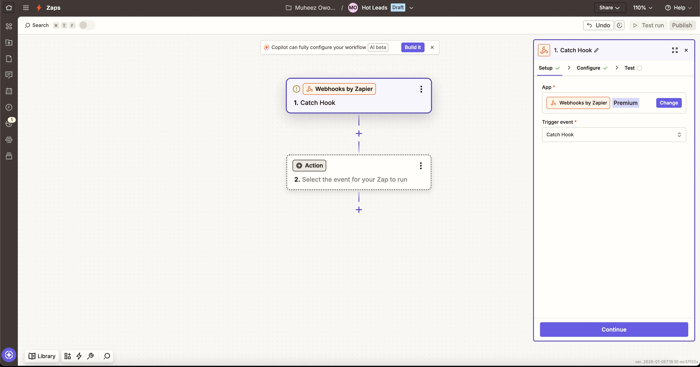
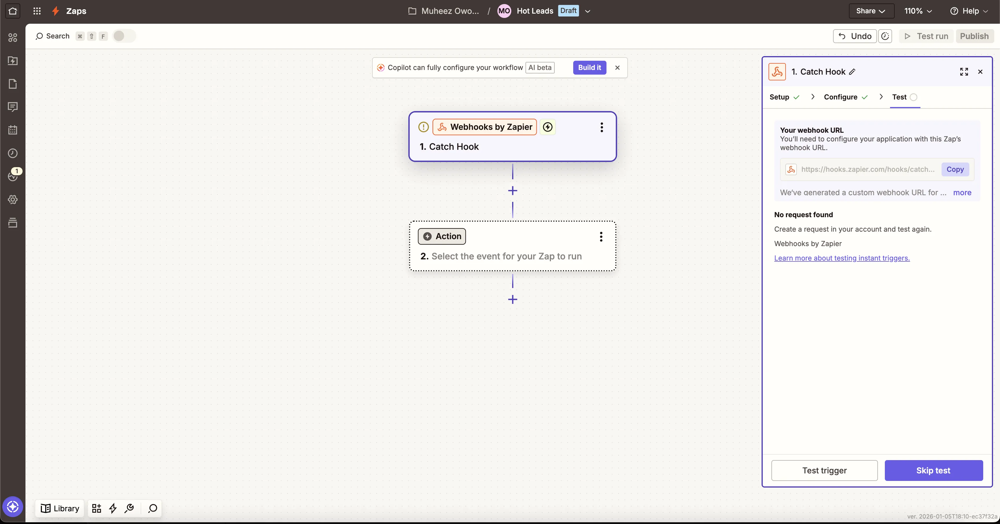
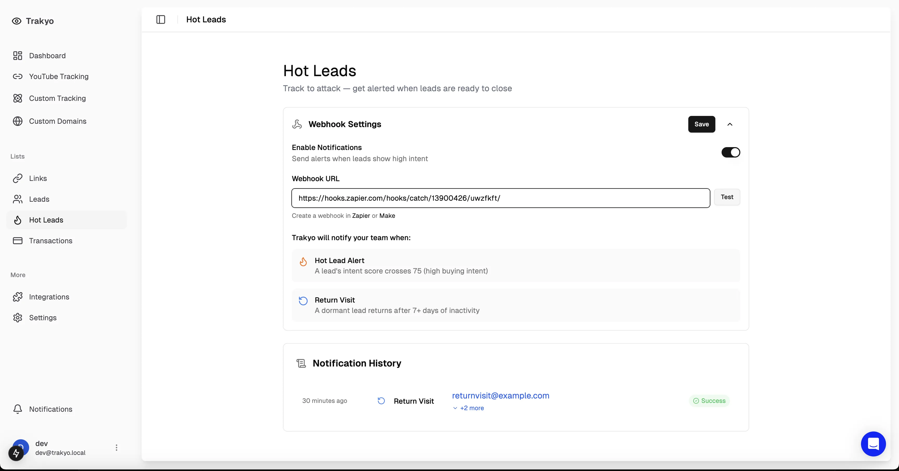
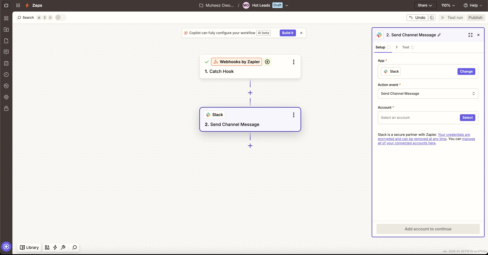
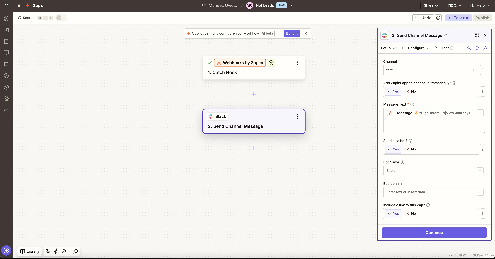
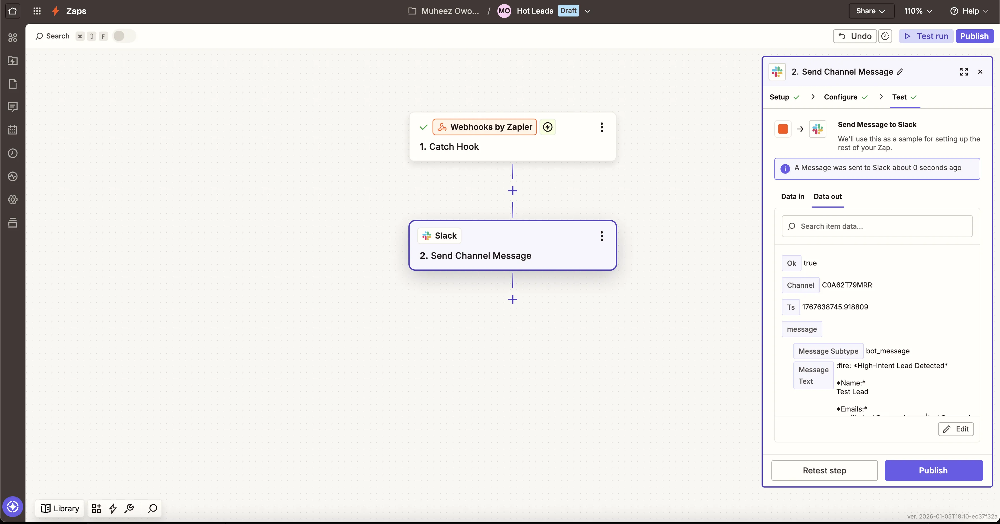

:::note[Demo article]
Shows what a finished article looks like. Part of a demo pull request: never published.
:::

Trakyo can tell you the moment a lead looks ready to buy. This guide sends those alerts
to a Slack channel through Zapier.

## Step 1: Create a Zap that catches a webhook

In Zapier, create a new Zap. For the trigger choose **Webhooks by Zapier**, then
**Catch Hook**, and click **Continue**.

## Step 2: Copy the webhook URL

Zapier shows a unique webhook URL. Copy it.

## Step 3: Paste it into Trakyo

In Trakyo, open **Hot Leads**, turn notifications on, paste the URL and click **Save**.
Then click **Test** to send a test alert.

## Step 4: Send it to Slack

Back in Zapier, add an action: **Slack → Send Channel Message**. Pick the channel, and for
the message insert the **Message** field from the webhook. It already contains the lead's
name, email and intent score.

:::tip
Make a dedicated channel like `#hot-leads` so alerts don't get lost.
:::

## Step 5: Test and publish

Test the action, check the message arrived in Slack, then click **Publish**.

