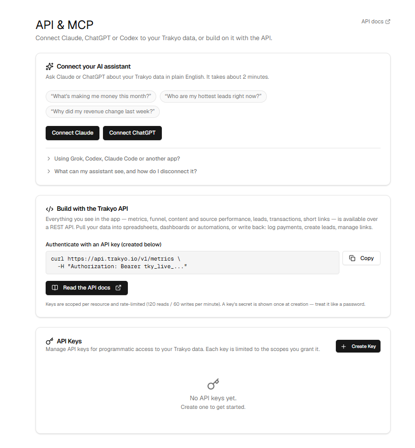

Everything you see in **Trakyo** is open to your AI assistant and to your own code. Ask
Claude or ChatGPT about your data in plain English, or build on the REST API.


---

## Connect your AI assistant

Open the **API & MCP** page in **Trakyo**. It takes about two minutes.

1. Click **Connect Claude** or **Connect ChatGPT**.
2. Approve access in the browser window that opens.
3. Ask it something, such as "What's making me money this month?"



### Using Grok, Codex, Claude Code or another app

Any app that supports remote MCP servers — Streamable HTTP with OAuth — works. Point it at
this URL and approve access in the window that opens. Leave any API-key field empty.

```text
https://mcp.trakyo.io/mcp
```

**Codex**

```bash
codex mcp add trakyo --url https://mcp.trakyo.io/mcp
```

```bash
codex mcp login trakyo
```

The first command opens the approval screen. Run the second if it did not, or to reconnect
later.

**Claude Code**

```bash
claude mcp add --transport http trakyo https://mcp.trakyo.io/mcp
```

**Grok**

On grok.com, open **Connectors**, add a custom connector and paste the URL above. In Grok
Bot, or in Cursor, add it as a remote MCP server.

:::note
Grok Bot and Cursor share one connection. Connecting one replaces the other.
:::

---

## What your assistant can see

Your metrics, your content and source performance, your leads — contact details, journeys
and notes — your payment history and your short links, across the whole account.

It is view-only unless you ticked **allow changes** on the approval screen, and a deletion
always asks you to confirm in the chat first.

:::note
Agencies also see **read all your client accounts** on that screen. Leave it ticked to ask
about any client you manage, read-only.
:::

### Disconnect it

Revoke the key named `claude-mcp-…` in the API keys list, and remove the Trakyo connector
in your AI app.

:::tip
The server URL is safe to share. Connecting always means signing in to **Trakyo** and
approving access first.
:::

---

## Build with the Trakyo API

Everything in the app — metrics, funnel, content and source performance, leads,
transactions, short links — is available over a REST API. Pull your data into spreadsheets,
dashboards or automations, or write back to it: log payments, create leads, manage links.

### Create an API key

On the same page, under **API Keys**, click **Create Key** and grant it the scopes it
needs. Each key is limited to the scopes you give it.

:::warning
The secret is shown once, when you create the key. Treat it like a password.
:::

### Authenticate your requests

Send the key as a bearer token:

```bash
curl https://api.trakyo.io/v1/metrics \
  -H "Authorization: Bearer tky_live_..."
```

:::note
Keys are rate-limited to 120 reads and 60 writes a minute.
:::

---

:::info
Learn more in the **[API reference](/docs/api)**.
:::
