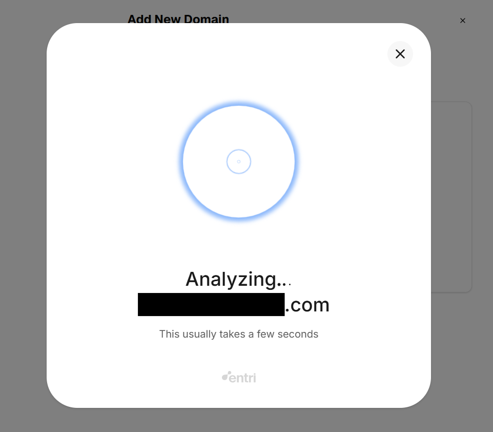
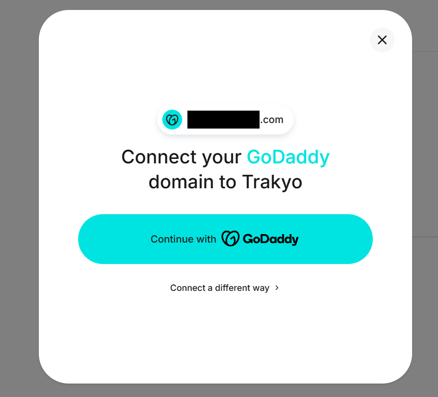
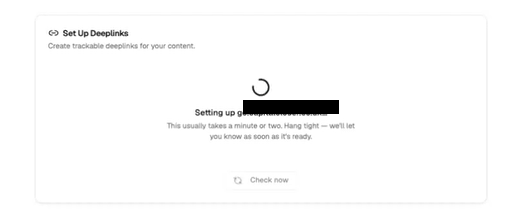
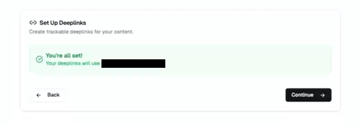
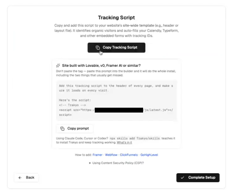

Connecting a custom domain is the most important step of your setup. It is what **Trakyo**
tracking links — deeplinks, or shortlinks — run on.

:::note
You do not need a landing page. If you send people straight to an application form or a
scheduler, that is fine. What you do need is a domain, so we can add DNS records for a
subdomain of it.
:::

:::warning[Before you start]
You need access to your domain registrar — where the domain is registered, which is not
necessarily where your site is built — with permission to change its DNS records.
:::

---

## Step 1 — Enter your domain

Type your domain as `www.example.com` or `example.com`, then click **Continue**.


---

## Step 2 — Pick your subdomain

This is what your links will start with. **Trakyo** suggests three:

- **go.** — the most popular choice.
- **r.** — short and simple.
- **to.** — action-oriented.


:::warning
Do not pick a subdomain you already use for something else. If it is already in use, the
DNS records cannot be set up.
:::

For something of your own — `apply`, `learn`, `access` — click **I want something
different** and type the word in.


:::note
Avoid `track`, `link`, `click` and `trk`. Those often get blocked.
:::

---

## Step 3 — Connect it

Two ways to do this.


### Let Trakyo set it up

Click **Connect domain**. Your domain is checked to see who it is registered with, which
takes a few seconds.



Then click **Continue with** your provider — GoDaddy, in this example — sign in there, and
approve the change. The records are added for you.

**Connect a different way** takes you to the manual route instead.



### Add the records yourself

Go to your domain provider and add both of these:

| Type | Name / Host | TTL | Value |
| --- | --- | --- | --- |
| A | `go` | Auto | `37.16.18.176` |
| AAAA | `go` | Auto | `2a09:8280:1::d0:1e75:0` |


:::note
**Name / Host** is whichever subdomain you chose in step 2. Everything else stays the same.
Copy the values from the dialog rather than from here, so you always have the current ones.
:::

Add both. The AAAA record lets phones on IPv6 networks reach your links directly, which is
what connects an Instagram click to that same person's next click.

**Using DNSSEC?** If your domain has it enabled, add a CAA record as well, so SSL
certificates can be issued:

| Type | Name | Flag | Tag | Value |
| --- | --- | --- | --- | --- |
| CAA | `go` | 0 | issue | `letsencrypt.org` |

Then click **I've added the records**, and **Trakyo** starts checking with your registrar.
DNS changes can take up to 48 hours to spread, though they usually happen within minutes.

---

## Step 4 — Wait for it to go live

Whichever route you took, **Trakyo** now sets the domain up with your registrar. It usually
takes a minute or two.



When it is done you get **You're all set!**, with the domain your deeplinks will use. Click
**Continue**.



---

## If the check never finishes

Work through these:

- **The domain is new.** A recently bought domain takes longer to propagate.
- **The records do not match.** Check them against the dialog, character for character.
- **Your DNS lives somewhere else.** If Cloudflare, GoHighLevel or another service manages
  the domain's DNS rather than the registrar, the records have to be added there.
- **The subdomain is already in use.** Pick another one.

---

## Step 5 — Add the tracking script

The last step is a small script on your landing pages.

:::note
Skip this if you do not send people to a landing page — if your links go straight to an
application form or a scheduler, there is nothing to add.
:::

### What the script does

- **It takes a fingerprint of the visitor**, so **Trakyo** can attribute what they do next
  precisely.
- **It recognises visitors who arrive without clicking a tracking link**, and usually tells
  you the last page they were on before yours — Google, Instagram, Facebook, YouTube. Those
  show on your dashboard as **Referrers**.

Referrers are how you find the links you have missed. If YouTube keeps appearing there even
though every video description is updated, the gap is somewhere else: your channel bio, a
pinned comment, or another channel entirely.

:::note
When a visitor's browser blocks that information, the visit counts as **Other** on your
dashboard.
:::

### Copy the script

For an ordinary site builder — Framer, Webflow, ClickFunnels, GoHighLevel, Wix — click
**Copy Tracking Script** and paste it into the `<head>` of every page. Most builders have
one site-wide setting for that, so you only paste it once.



```html
<script src="https://go.yourdomain.com/api/js/latest.js"></script>
```

:::note
Copy your own script from **Trakyo**. It carries your domain, not the example above.
:::

### Copy the prompt

For an AI site builder — Lovable, Replit, Netlify, Base44 — click **Copy prompt** instead
and paste that into the builder. It covers the two things people usually miss:

```text
Add this tracking script to the header of every page, and make sure it loads on every
visit.

Here's the script:
<script src="https://go.yourdomain.com/api/js/latest.js"></script>

Additionally, allow trakyo_id to be collected from the URL by any form or third-party
embedded tool on the site.

Also, ensure URL parameters — especially trakyo_id — are passed forward with every page
navigation and redirect.
```

### Carry the id across your pages

Every click adds that visitor's own `trakyo_id` to the URL, alongside your other
parameters such as the ones Meta adds. Your pages have to pass those parameters on with
every navigation and every redirect, so the id survives to whatever comes next.

That is what lets a form or a scheduler collect the fingerprint and attach it to the
booking or the submission. The AI prompt above asks for it. On a builder like Framer you
add the logic yourself.

:::warning
How much of this you need depends on your funnel. A redirect handled by your site, a button
that opens a scheduler, and a form that redirects on submit all behave differently.
:::

Articles on each builder — where the script goes, and how to carry parameters forward —
are on their way.

---

:::danger
Once your links are live, leave those DNS records alone. Change or delete them at your
registrar and every deeplink breaks — leads can no longer reach your destination URLs.
:::

---

:::info
Learn more about **[Custom Tracking](/docs/help/custom-tracking/overview)** here.
:::
