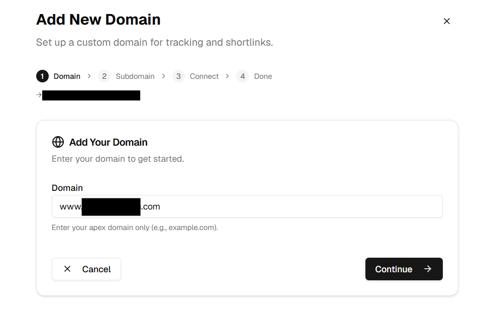
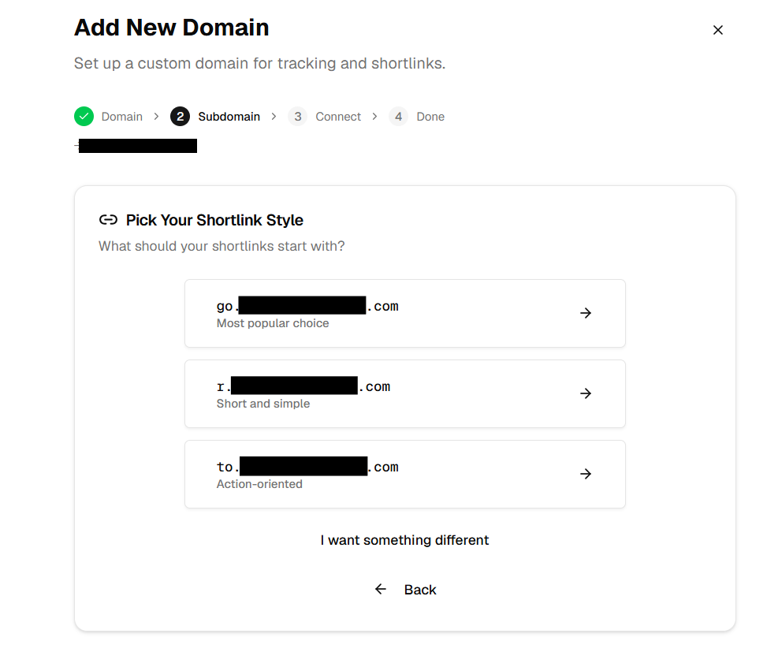
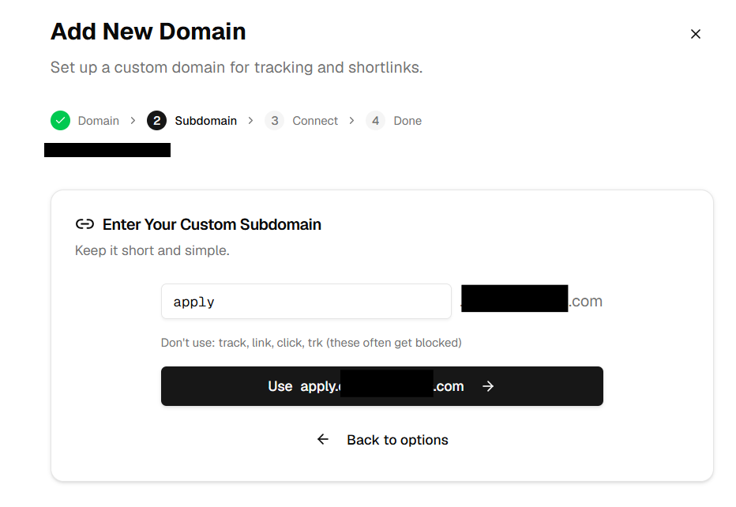
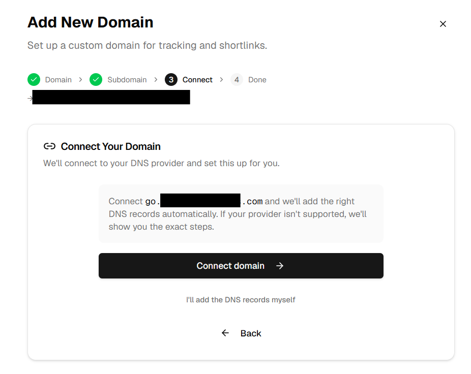
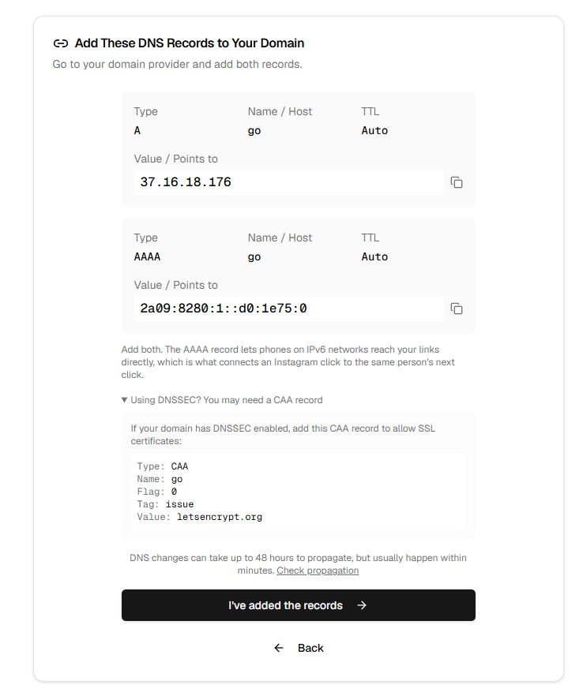

Connecting a custom domain is the most important step of your setup. It is what **Trakyo**
tracking links — deeplinks, or shortlinks — run on.

:::note
You do not need a landing page. If you send people straight to an application form or a
scheduler, that is fine. What you do need is a domain, so we can add DNS records for a
subdomain of it.
:::

:::warning[Before you start]
You need access to your domain registrar — where the domain is registered, which is not
necessarily where your site is built — with permission to change its DNS records.
:::

---

## Step 1 — Enter your domain

Type your domain as `www.example.com` or `example.com`, then click **Continue**.

---

## Step 2 — Pick your subdomain

This is what your links will start with. **Trakyo** suggests three:

- **go.** — the most popular choice.
- **r.** — short and simple.
- **to.** — action-oriented.

:::warning
Do not pick a subdomain you already use for something else. If it is already in use, the
DNS records cannot be set up.
:::

For something of your own — `apply`, `learn`, `access` — click **I want something
different** and type the word in.

:::note
Avoid `track`, `link`, `click` and `trk`. Those often get blocked.
:::

---

## Step 3 — Connect it

Two ways to do this.

**Let Trakyo set it up.** Click **Connect domain**. We work out who your DNS provider is,
you sign in to them, and the records are added for you.

**Add the records yourself.** Click **I'll add the DNS records myself** and **Trakyo**
shows you exactly what to add.

### Adding the records yourself

Go to your domain provider and add both of these:

| Type | Name / Host | TTL | Value |
| --- | --- | --- | --- |
| A | `go` | Auto | `37.16.18.176` |
| AAAA | `go` | Auto | `2a09:8280:1::d0:1e75:0` |

:::note
**Name / Host** is whichever subdomain you chose in step 2. Everything else stays the same.
Copy the values from the dialog rather than from here, so you always have the current ones.
:::

Add both. The AAAA record lets phones on IPv6 networks reach your links directly, which is
what connects an Instagram click to that same person's next click.

**Using DNSSEC?** If your domain has it enabled, add a CAA record as well, so SSL
certificates can be issued:

| Type | Name | Flag | Tag | Value |
| --- | --- | --- | --- | --- |
| CAA | `go` | 0 | issue | `letsencrypt.org` |

Then click **I've added the records**, and **Trakyo** starts checking with your registrar.
DNS changes can take up to 48 hours to spread, though they usually happen within minutes.

---

## If the check never finishes

Work through these:

- **The domain is new.** A recently bought domain takes longer to propagate.
- **The records do not match.** Check them against the dialog, character for character.
- **Your DNS lives somewhere else.** If Cloudflare, GoHighLevel or another service manages
  the domain's DNS rather than the registrar, the records have to be added there.
- **The subdomain is already in use.** Pick another one.

---

:::danger
Once your links are live, leave those DNS records alone. Change or delete them at your
registrar and every deeplink breaks — leads can no longer reach your destination URLs.
:::

---

:::info
Learn more about **[Custom Tracking](/docs/help/custom-tracking/overview)** here.
:::
