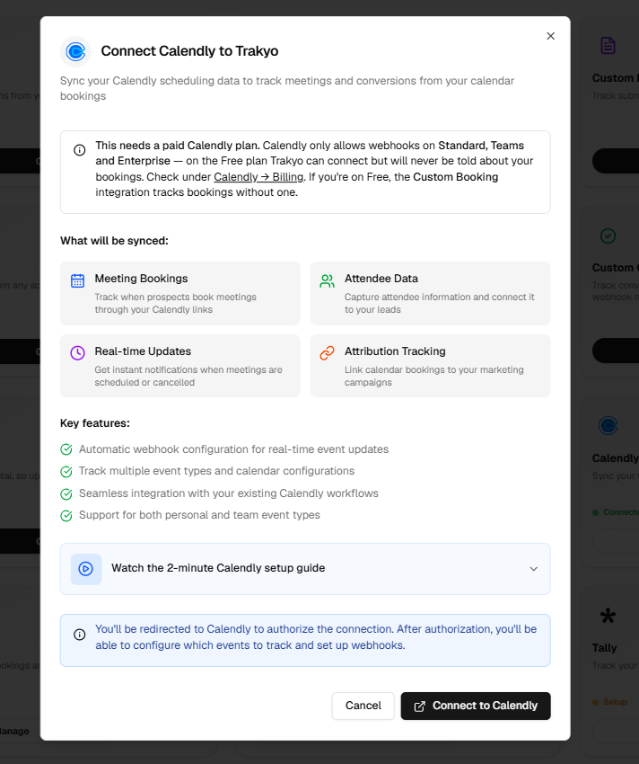
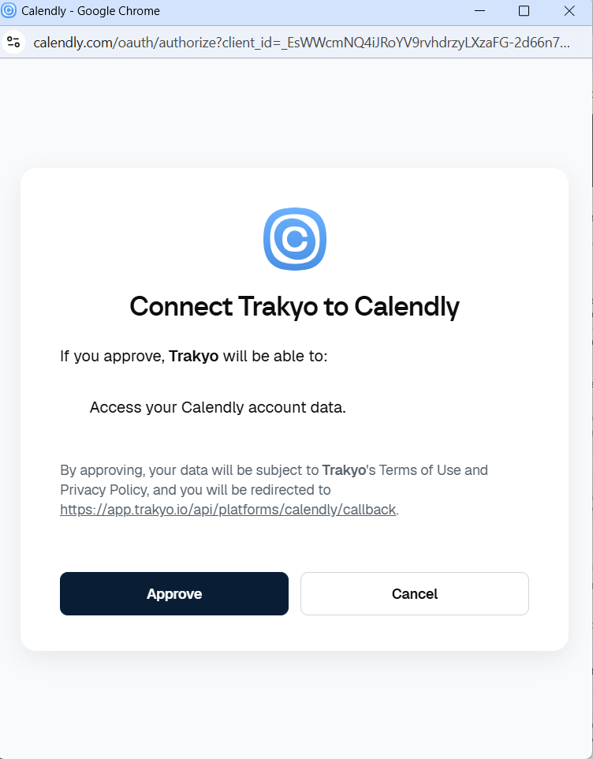
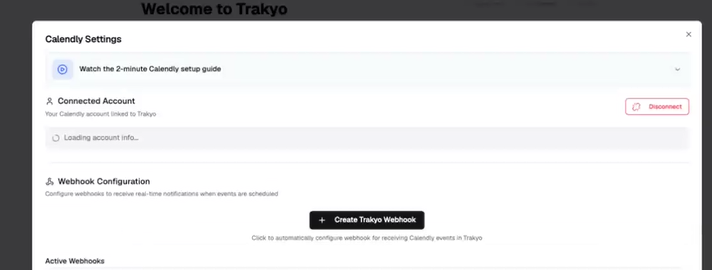
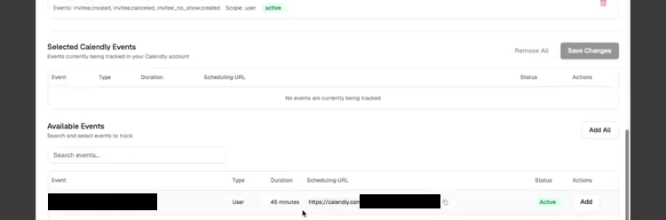

The **Trakyo** integration with Calendly tracks the meetings booked through your Calendly
links and attributes each booking to the content that produced it.

:::warning
Calendly only allows webhooks on its paid plans — Standard, Teams and Enterprise — which you
can check under **Calendly** → **Billing**.

If you are on the Free plan, you can still connect **Trakyo** with a Zapier, Make or n8n
trigger that sends the booking to the webhook in
**[Custom Booking](/docs/help/integrations/custom-booking)** instead.
:::

---

## Connect your Calendly account

Open the **[Integrations](https://app.trakyo.io/integrations)** page in **Trakyo**, find the
Calendly card, and click **Connect to Calendly**.

You are taken to Calendly to authorise the connection. Click **Approve**, and Calendly sends
you back to **Trakyo**.

:::tip
Connecting Calendly gives you:

- the meetings prospects book through your Calendly links,
- the attendee's details, tied to their lead,
- bookings as they happen,
- each booking attributed to the content that produced it.
:::

---

## Create the webhook

Your connected account now shows in the Calendly settings window. Under **Webhook
Configuration**, click **Create Trakyo Webhook**.

---

## Choose the events to track

**Trakyo** tracks the event types you pick, not everything on your calendar.

1. Under **Available Events**, find an event type and click **Add**. It moves up to
   **Selected Calendly Events**.
2. Repeat for every event type you want tracked. **Add All** takes the lot, **Remove All**
   clears the list.
3. Click **Save Changes**.

:::tip
Track the event types that are part of your sales journey — discovery calls, sales calls,
demos. Leave out internal meetings, and the onboarding calls that happen once a lead has
already closed. Your booking numbers then describe demand, rather than how busy your
calendar is.
:::

---

## Test the integration

1. Book a meeting through one of the event types you are tracking.
2. Open **[Leads](https://app.trakyo.io/leads)** in **Trakyo** and check the booking is
   listed against that person, with the content that brought them in.

---

:::info
Learn more about the **[Leads page](/docs/help/leads/overview)** here.
:::
