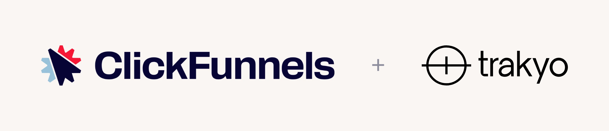
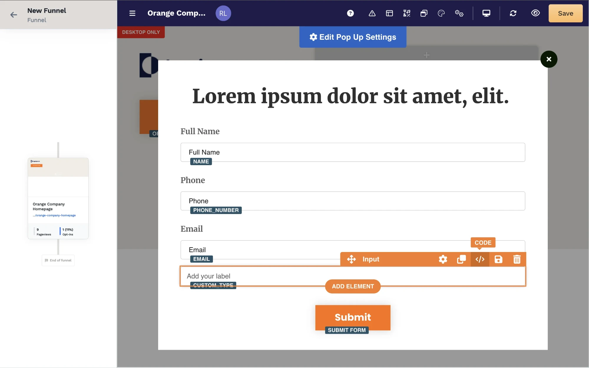
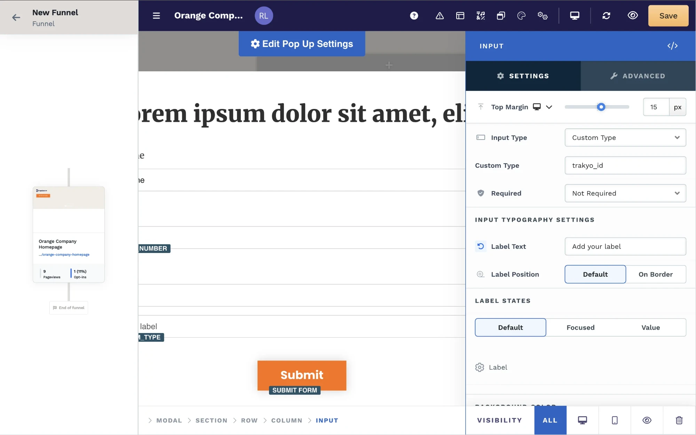
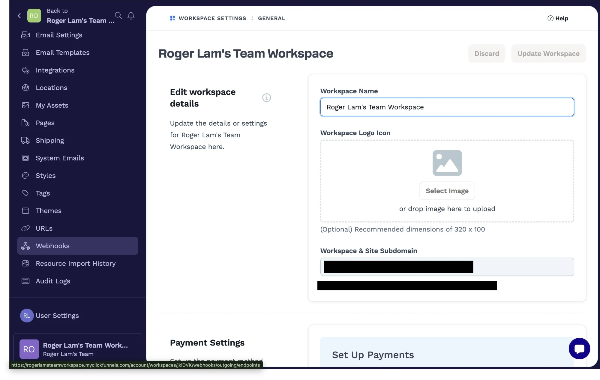
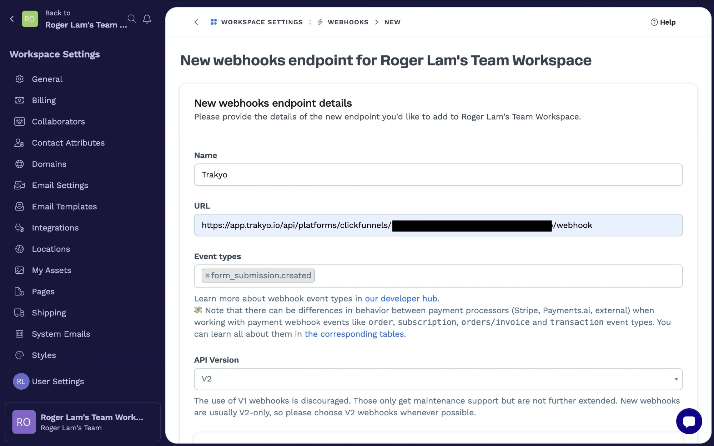

The **Trakyo** integration with ClickFunnels tracks the leads who submit the forms on your
funnel pages, and ties each one back to the content that brought them in.



:::tip
Integration requires two steps:

- a hidden field on every form you want tracked,
- one webhook that sends those submissions to **Trakyo**.

It does not cover configuring your ClickFunnels pages, or adding the tracking script to
pages built on ClickFunnels — that is in the Custom Domains article.
:::

---

## Form configuration

The hidden field carries the visitor id through the form, so the submission arrives in
**Trakyo** with the click that produced it.

1. Open the **Funnels** tab and click the funnel you want to track.
2. Click **Edit** on each page that has a form or opt-in on it.
3. Go to the form on that page.
4. Add an **Input** element anywhere in the form. You will hide it in a moment.



5. Click the new input element and set it up:
   1. **Input Type** — choose **Custom Type**.
   2. **Custom Type** — enter `trakyo_id`.
   3. **Required** — choose **Not Required**.



6. Hover over the input and click the **Code** icon.
7. Enter `trakyo-input` in the **CSS ID Selector** field and click **Update**, then paste
   this CSS to hide the element:

```css
#trakyo-input {
  display: none;
}
```

8. Click **Save** at the top right to apply everything.

:::warning
Repeat this for every page that captures a lead. A page whose form has no `trakyo_id` field
records the submission without the click that produced it, so its revenue lands under
**Other**.
:::

---

## Form workflow automation setup

The webhook is what delivers each submission to **Trakyo**.

1. On the ClickFunnels home page, click **Workspace Settings** at the bottom left.
2. Select **Webhooks** in the left sidebar.



3. Click **Add new endpoint**.
4. Fill it in:
   1. **Name** — `Trakyo`, or any name you recognise.
   2. **URL** — the webhook URL from your ClickFunnels card on the
      **[Integrations](https://app.trakyo.io/integrations)** page. It is unique to your
      account, so copy it from there rather than from anywhere else.
   3. **Event Types** — select `form_submission.created`.



5. Scroll to **Endpoint scopes** and select **only** the funnels you set up above.
6. Scroll to the bottom and click **Create endpoint**.

:::danger
Do not leave **Endpoint scopes** blank, and do not select funnels you have not configured.
Blank means every funnel, and a funnel whose forms have no `trakyo_id` field sends
submissions that cannot be attributed.
:::

---

## Test the integration

1. Click one of your tracking links and let it take you to the funnel page.
2. Check that `trakyo_id` appears in the URL as a parameter.
3. Fill the form in and submit it.
4. Open **[Leads](https://app.trakyo.io/leads)** in **Trakyo** and look for your test lead,
   searching by the email address you entered.
5. Open the lead and check it shows your details along with its attribution.

---

:::info
Learn more about the **[Leads page](/docs/help/leads/overview)** here.
:::
