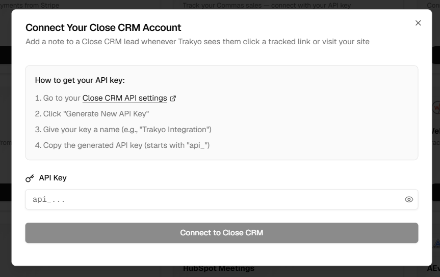

The **Trakyo** integration with Close CRM adds a note to a lead whenever **Trakyo** sees
that person click a tracked link or visit your site, so your reps see the activity without
leaving Close.

---

## Get your Close CRM API key

1. Open your
   **[Close CRM API settings](https://app.close.com/settings/developer/api-keys/)**.
2. Click **Generate New API Key**.
3. Give it a name, such as `Trakyo Integration`.
4. Copy the key. It starts with `api_`.

---

## Connect it in Trakyo

Open the **[Integrations](https://app.trakyo.io/integrations)** page in **Trakyo**, find the
Close CRM card, paste the key in and click **Connect to Close CRM**.

---

## Test the integration

1. Open one of your tracked links as a lead who already exists in Close, or visit your site
   as one.
2. Open that lead in Close CRM and check a note from **Trakyo** is on their timeline.

---

:::info
Learn more about the **[Leads page](/docs/help/leads/overview)** here.
:::
