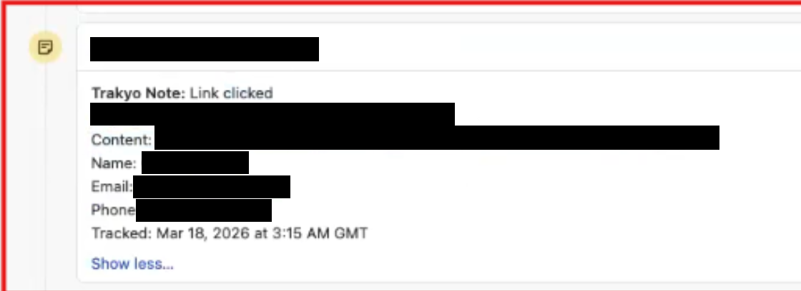
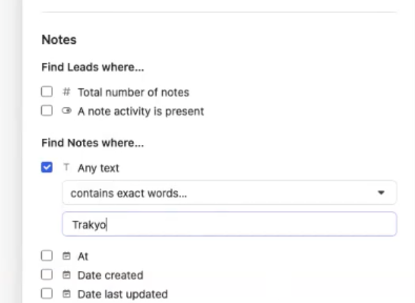

The **Trakyo** integration with Close CRM adds a note to a lead whenever **Trakyo** sees
that person click a tracked link or visit your site, so your reps see the activity without
leaving Close.

:::warning
**Trakyo** looks the person up in Close by their email address, and falls back to their
phone number if that finds nothing. If neither matches a lead in Close, nothing is written
— **Trakyo** does not create leads in Close.
:::

---

## Get your Close CRM API key

1. Open your
   **[Close CRM API settings](https://app.close.com/settings/developer/api-keys/)**.
2. Click **Generate New API Key**.
3. Give it a name, such as `Trakyo Integration`.
4. Copy the key. It starts with `api_`.

---

## Connect it in Trakyo

Open the **[Integrations](https://app.trakyo.io/integrations)** page in **Trakyo**, find the
Close CRM card, paste the key in and click **Connect to Close CRM**.

---

## What the note says

Every note follows the same template:

- **Trakyo Note: Link clicked** as the title.
- **URL** — the link they clicked.
- **Content** — where they clicked it.
- **Name**, **Email** and **Phone** — the lead's details.
- **Tracked** — the date and time, in GMT.

The note is posted by one of your **Trakyo** users, so it appears in Close as that person
having created it.

---

## Find the leads Trakyo has noted

1. Open the **Leads** page in Close CRM.
2. Click **Filters** and type `Note` in the search bar at the top.
3. Choose **Find Notes where…**, set it to **Any text**, **contains exact words**, and type
   `Trakyo`.

Close then lists every lead with a **Trakyo** note on their activity.

---

## Test the integration

1. Open one of your tracked links as a lead who already exists in Close, with the email
   address or phone number Close holds for them.
2. Open that lead in Close CRM and check the **Trakyo** note is on their activity.

:::note
Want more than a note? Send whatever you like to Close with your own automation, built on
the **[Trakyo API and MCP](/docs/help/settings/api-and-mcp)**.
:::

---

:::info
Learn more about the **[Leads page](/docs/help/leads/overview)** here.
:::
