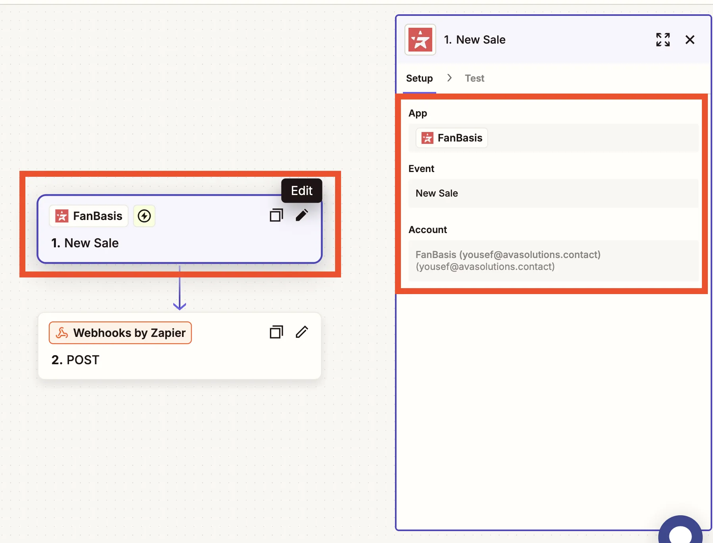
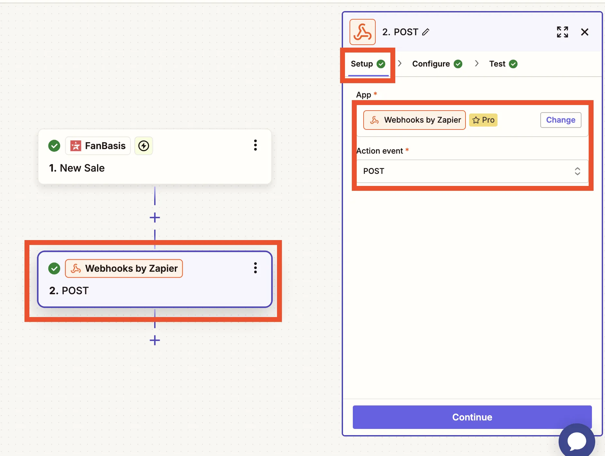
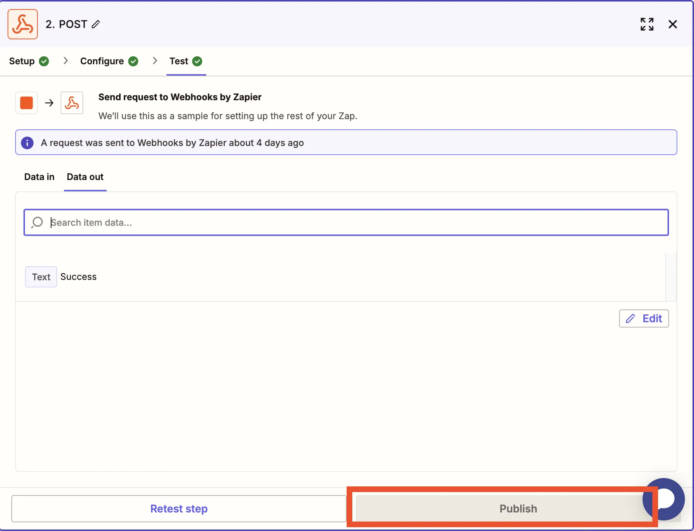

The **Trakyo** integration with Commas tracks the payments taken through your Commas account
and attributes each one to the content that produced it. There are two ways to connect: with
your Commas API key, or through Zapier.

---

## Connect with your API key

1. Sign in to your Commas dashboard and go to **Account** → **API Keys**.
2. Create a key, name it `Trakyo`, and copy it.
3. Open the **[Integrations](https://app.trakyo.io/integrations)** page in **Trakyo**, find
   the Commas card, paste the key in and click connect.

---

## Connect through Zapier

:::note
Zapier still lists Commas under its former name, **FanBasis**. The screenshots below show it
that way.
:::

### Set up the trigger

Open your Zapier dashboard and create a new Zap, or edit an existing one.

1. Choose **Commas** as the app and **New Sale** as the trigger event.
2. Connect your Commas account to Zapier if you have not already.
3. Click **Test** to load a sample payload.

---

### Set up the action

Choose **Webhooks by Zapier** as the app and **POST** as the action event.

:::note
Zapier needs a paid plan for this: webhook steps are not available on its free tier.
:::

---

### Configure the webhook

On the **Configure** step:

1. Paste `https://app.trakyo.io/api/platforms/fanbasis` as the **URL**.
2. Choose **Json** as the **Payload Type**.

---

### Map the fields

Four fields are required. In Zapier's data panel, type `/` in each value field and pick the
matching tag from the dropdown.

| Field | Tag from Commas |
| --- | --- |
| `email` | **Email** |
| `phone_number` | **Phone Number** |
| `earnings` | **Earnings** |
| `name` | **Full Name** |

Two more are optional:

- `currency` — map **Currency** to track revenue in the right currency. Send a three-letter
  code, such as `USD`, `EUR` or `GBP`. Without it, payments are assumed to be in US dollars.
- `api_metadata__trakyo_id` — map **Api Metadata Data Trakyo Id** if your Commas checkout
  carries the visitor's `trakyo_id`, which checkouts made through the Commas API or its
  embedded checkout do. Each sale is then credited to the visit that led to it. Zapier lists
  the tag only when the sale it tested with carries one, so type `/trakyo` to find it.

:::note
Everything else is optional. **Trakyo** fills in sensible defaults for the fields you leave
out.
:::

---

### Add the signature header

1. Set **Wrap Request In Array** to **No**, and **Unflatten** to **Yes**.
2. Under **Headers**, enter `X-Trakyo-Signature` as the key.
3. Generate your signature key on the Commas card in **Trakyo**, copy it, and paste it in as
   the value.
4. Click **Continue**.

:::warning
The signature key is unique to your account. Copy it from the Commas card on the
**[Integrations](https://app.trakyo.io/integrations)** page rather than from anywhere else.
:::

---

### Test and publish

Test the step, then click **Publish**.

---

## Test the integration

1. Take a payment through Commas, or find one you have taken recently.
2. Open **[Transactions](https://app.trakyo.io/transactions)** in **Trakyo** and check it is
   listed, with the right amount and currency.
3. Open the lead it belongs to and check the payment sits on their journey with its
   attribution.

---

:::info
Learn more about the **[Transactions page](/docs/help/transactions/overview)** here.
:::
