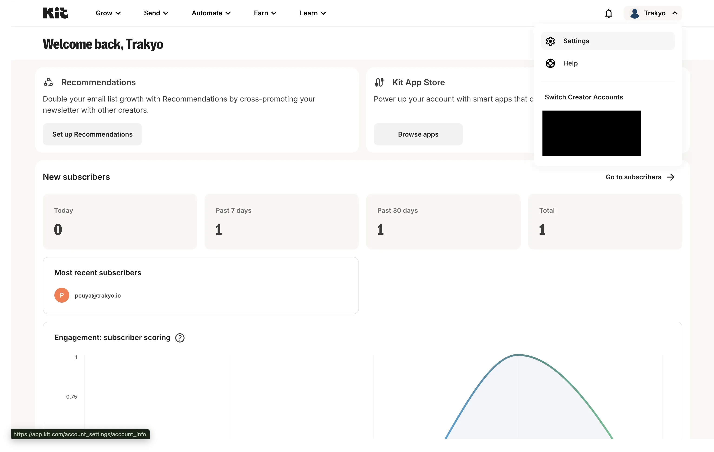
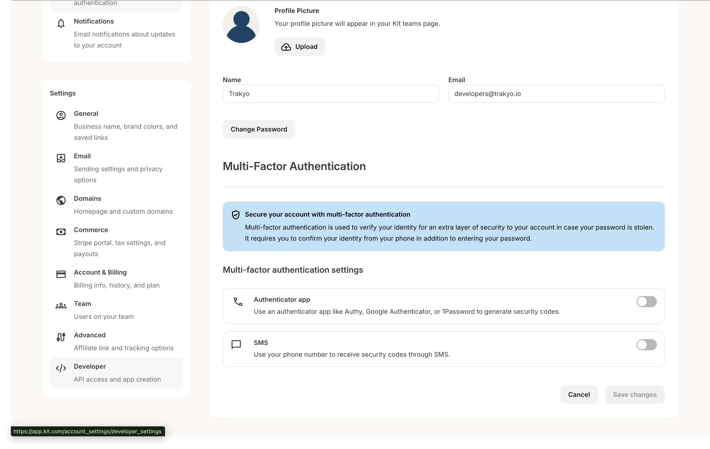
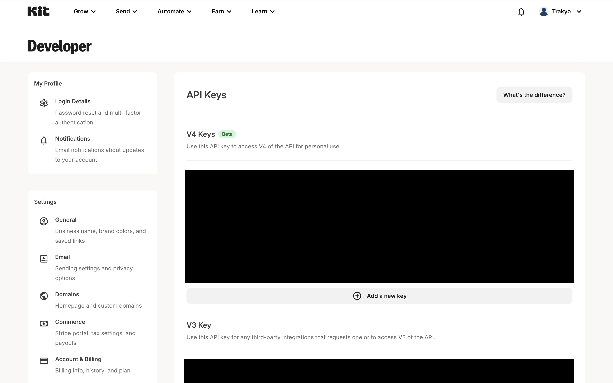
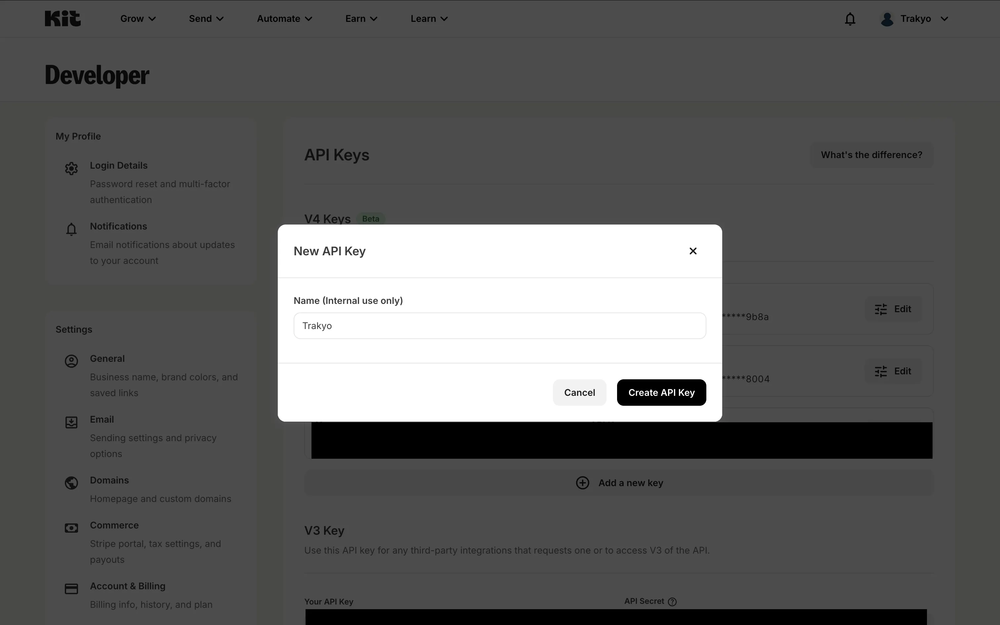
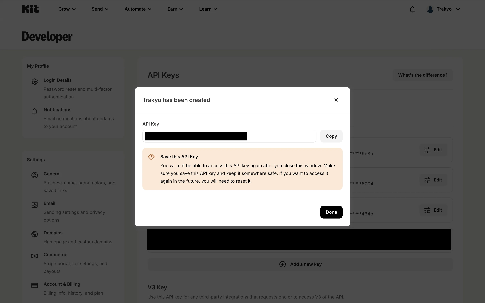

:::note[Demo article]
Shows what a finished article looks like. Part of a demo pull request: never published.
:::

Connecting Kit lets Trakyo see every new subscriber and trace them back to the content
they came from. It takes about five minutes.

:::note[Before you start]
- You need a Kit login with access to **Settings**.
- Kit has two kinds of API keys. Trakyo needs a **V4** key.
:::

## Step 1: Open your Kit settings

In Kit, open your account menu and click **Settings**.

## Step 2: Open API & Webhooks

In the Settings menu, click **API & Webhooks**.

## Step 3: Reveal your API secret

Under your V4 keys, click **Show** to reveal the API secret.

:::warning
Use a **V4** key. A V3 key looks similar but Trakyo can't read your subscribers with it.
:::

## Step 4: Copy it

Click the copy button. Keep the secret private: anyone with it can read your subscriber list.

## Step 5: Paste it into Trakyo

In Trakyo, go to **Integrations → Kit**, paste the secret and click **Connect**.

## Check it worked

Subscribe to one of your own forms with a test email. Within a few minutes the test
subscriber appears on the **Leads** page.
