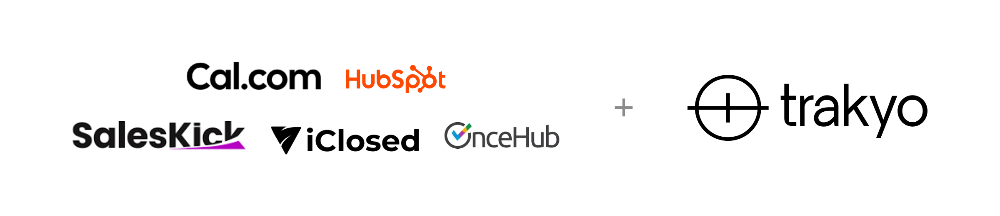

The **Trakyo** Custom Booking integration tracks calls booked on any scheduling tool that
has no direct integration — Cal.com, SavvyCal, Acuity, TidyCal, OnceHub, or anything
custom — and attributes each booking to the content that produced it.



:::tip
Integration requires two steps:

- capture the `trakyo_id` on your booking form,
- send each booking to **Trakyo** from an automation or your backend.

Every scheduler handles custom fields differently, so step one looks different in each
tool. It does not cover adding the tracking script to your pages — that is in the Custom
Domains article.
:::

---

## How it works

1. A visitor lands on your site, and the Trakyo tracking script gives them a unique
   `trakyo_id`.
2. They book a call on your scheduling tool.
3. An automation — Zapier, Make, n8n or your own backend — POSTs the booking to your
   Trakyo webhook.
4. **Trakyo** attributes the booking to that visitor, and to the content that drove them.

---

## Capture the Trakyo visitor id

Add a field named `trakyo_id` to your booking form, or as a custom contact property in your
scheduler. The Trakyo tracking script fills any field with that name with the visitor's id,
so leave its value empty.

```html
<input type="hidden" name="trakyo_id" />
```

Schedulers name and place custom fields differently, so where this lives varies by tool.
In Cal.com, for instance, it is a hidden, non-required field on the booking form.

:::tip
If your scheduler does not allow hidden fields, use a visible short-text field with an
innocuous label such as "Reference". Trakyo still pre-fills it.
:::

---

## Send booking data to Trakyo

When a booking is created, POST it to your **Trakyo** webhook. Most people do this with
Zapier or Make, using the scheduler's "new booking" trigger.

Zapier needs a paid plan for this: webhook steps are not available on its free tier.

:::warning
The webhook URL is unique to your account. Copy it from the Custom Booking card on the
**[Integrations](https://app.trakyo.io/integrations)** page rather than from anywhere else.
:::

Send a POST request with a JSON body, using these field names exactly:

```json
{
  "trakyo_id": "{{trakyo_id from booking form}}",
  "email": "visitor@example.com",
  "name": "Jane Doe",
  "phone": "+1234567890",
  "event_name": "Discovery Call"
}
```

At minimum, send one of `trakyo_id`, `email` or `phone`.

`trakyo_id` gives the most accurate attribution. Some scheduling tools allow no custom
fields at all — in that case skip the step above and send `email` instead, and **Trakyo**
matches the booking to the lead by email address.

:::tip
Several people taking calls? Add their name to the end of `event_name` — "Discovery Call —
Anna" — so you can tell the bookings apart in **Trakyo**.
:::

---

## A booking page built with an AI builder

Building on Lovable, v0, Bolt, Replit or Framer AI? Paste this prompt into the builder
instead of wiring it up by hand. It covers the part everyone misses: sending the booking
before the page redirects to the confirmation.

Replace the webhook URL with your own from the Custom Booking card on the
**[Integrations](https://app.trakyo.io/integrations)** page.

```text
Send my booking data to Trakyo, following these instructions exactly.

1. Add a hidden input named `trakyo_id` to the booking form. Leave its value empty — the
   Trakyo tracking script on the page fills it in automatically. Do not remove it, rename
   it, or generate a value for it yourself.
   If the booking widget is a third-party embed that cannot take a hidden field, add a
   short-text field named `trakyo_id` instead (label it something like "Reference"); the
   script pre-fills that too. If neither is possible, skip this step and rely on the email
   below.
2. When a booking is confirmed, POST it as JSON to this webhook:
   [your webhook URL]
   Content-Type: application/json. Body fields, using these names exactly: trakyo_id,
   email, name, phone, event_name. Send whichever the booking collects — at minimum one of
   trakyo_id, email or phone.
3. Send that POST **before** redirecting to the confirmation page, and wait for it to
   finish (await the request). If you redirect first the request is cancelled and the
   booking is never recorded.
4. If the POST fails, still confirm the booking to the user — never block it on Trakyo.
   Log the error instead.
```

:::warning
Paste the whole prompt, not an extract, and test with a real booking afterwards. These
builders report success they have not delivered.
:::

---

## Test the integration

1. Click one of your tracking links and let it take you to the page with the booking form.
2. Check that `trakyo_id` appears in the URL as a parameter.
3. Book a call as a lead would.
4. Open **[Leads](https://app.trakyo.io/leads)** in **Trakyo** and look for your test lead,
   searching by the email address you entered.
5. Open the lead and check the booking is on its journey, with its attribution.

:::warning
If bookings do not arrive, check the page before the booking form first — the tracking
script and the `trakyo_id` in the URL — before reconnecting anything. A scheduler is the
last step in most funnels, so it inherits whatever broke earlier.

If the `trakyo_id` is not carried forward from the previous page to the page the scheduler
is embedded on, that logic has to be added in your webpage builder.
:::

---

:::info
Learn more about the **[Leads page](/docs/help/leads/overview)** here.
:::
