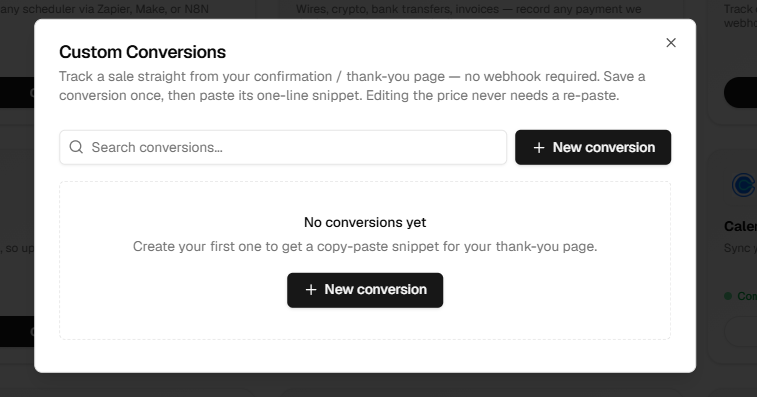
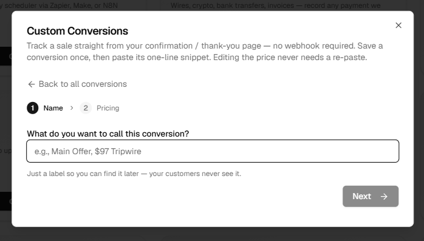
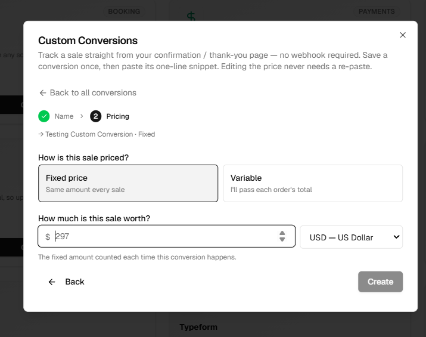
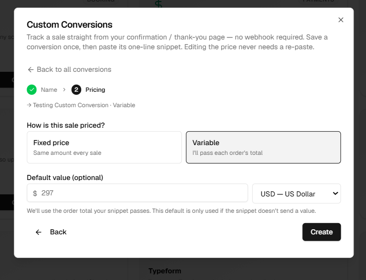

The **Trakyo** Custom Conversion integration records a sale from your confirmation or
thank-you page, with no webhook and nothing to build. You save a conversion once and paste
its one-line snippet onto the page customers land on after they pay.



:::tip
Use this when the buyer lands on a page you control after paying. If there is no such page
— a bank transfer, an invoice, a payment taken by hand — use Custom Transaction instead.
:::

---

## How it works

1. A visitor pays, and your checkout sends them to your confirmation page.
2. The snippet on that page fires a conversion as the page loads.
3. **Trakyo** matches the sale to the person and attributes it to the content that brought
   them in.
4. The sale appears on your **[Transactions](https://app.trakyo.io/transactions)** page.

Matching is automatic, with nothing to configure. **Trakyo** uses the visitor's cookie,
plus anything your checkout adds to the confirmation page's address — Stripe's
`?session_id=…`, an `?email=…` on the end of the URL, and so on.

The only sale that cannot be placed is one with no cookie, because they paid on a different
device, and no details in the address either.

---

## Create the conversion

Open the **[Integrations](https://app.trakyo.io/integrations)** page in **Trakyo**, find the
Custom Conversion card, and click **New conversion**.

1. Give it a name. This is a label for you — customers never see it — so use something you
   will recognise later, such as "Main Offer" or "$97 Tripwire".



2. Choose how the sale is priced:
   1. **Fixed price** — the same amount every sale. Enter the amount and currency.
   2. **Variable** — your snippet passes each order's total. You can set a default, which
      is used only when the snippet sends no value.





3. Click **Create**.

:::tip
Editing the price later never needs a re-paste. The snippet points at the saved conversion,
so changing the amount in **Trakyo** is enough.
:::

---

## Paste the snippet

Copy the snippet from the conversion you just created and paste it on your confirmation or
thank-you page — the page customers land on right after they pay.

```html
<script src="https://YOUR-TRACKING-HOST/api/js/c/YOUR-CONVERSION-ID.js"
        data-value="REPLACE_WITH_ORDER_TOTAL"
        defer></script>
```

:::warning
Copy your own snippet from the Custom Conversion card. The host and the conversion id in it
are unique to your account and to that conversion — a snippet copied from anywhere else
records sales against someone else's account.
:::

**On a variable conversion**, replace `REPLACE_WITH_ORDER_TOTAL` with the order total: a
number, or your page builder's merge tag, such as `{{order.total}}`. The currency comes
from the setting you saved on the conversion.

**On a fixed-price conversion**, the amount is the one you saved, so there is nothing to
replace.

---

## Test it

1. Open your confirmation page, which fires a conversion.
2. Back on the Custom Conversion card, click **Check for my test**.

:::warning
A test counts as a real conversion. Review or delete it on the
**[Transactions](https://app.trakyo.io/transactions)** page, filtering by "Conversion".
:::

This is a one-time install check. It confirms the snippet fired once; it does not keep
watching, so it will not notice if the snippet is removed from the page later.

---

:::info
Learn more about the **[Transactions page](/docs/help/transactions/overview)** here.
:::
