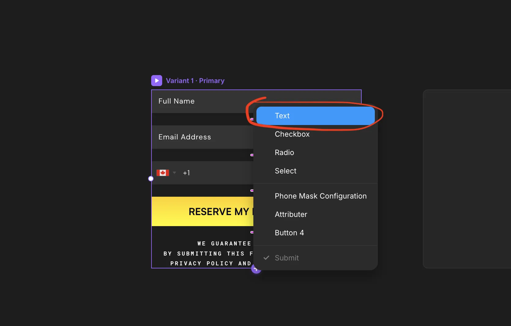
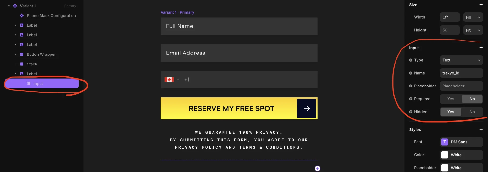
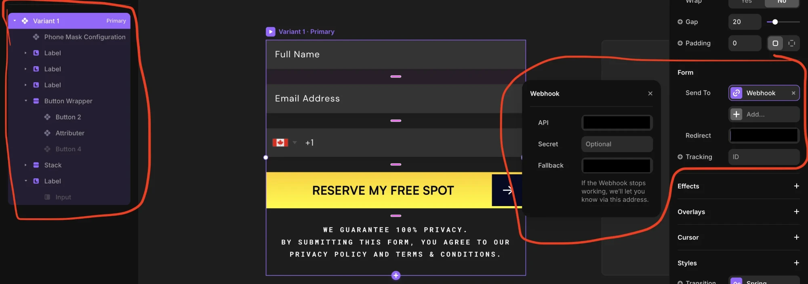

The **Trakyo** integration with Framer tracks the leads who submit the forms on your Framer
site, and ties each one back to the content that brought them in.


:::tip
Integration requires two steps:

- two hidden fields on every form you want tracked,
- the form's webhook pointed at **Trakyo**.

It does not cover configuring your Framer pages, or adding the tracking script to pages
built on Framer — that is in the Custom Domains article.
:::

---

## Form configuration

:::warning
Before you start, add the Trakyo tracking code to the head of your Framer site. Without it
there is no visitor id for the form to carry. See
**[Custom Domains](/docs/help/custom-domains/overview)**.
:::

Two hidden fields go on every form you want tracked: one carries the visitor id, the other
names the form so you can tell your submissions apart.

1. Open Framer and click the project that holds the website with your forms.
2. Select the page in the left sidebar, then click inside the asset the form sits in. The
   right sidebar is where you configure the hidden fields and the webhook.

### Adding trakyo_id hidden field

1. Add a **Text** input somewhere in the form. You will hide it in a moment.

   

2. Click the **Input** asset you just created in the left sidebar, find the **Input**
   section in the right sidebar, and set it up:
   1. **Type** — Text.
   2. **Name** — `trakyo_id`.
   3. **Placeholder** — leave empty.
   4. **Required** — No.
   5. **Hidden** — Yes.



### Adding form_name hidden field

Add a second hidden **Text** input. This one names the form, so you can filter your
submissions by form on the dashboard.

1. **Type** — Text.
2. **Name** — `form_name`.
3. **Value** — a name for this form, such as `Contact Form` or `Newsletter Signup`. Set the
   **Value**, not the Placeholder.
4. **Required** — No.
5. **Hidden** — Yes.

:::note
Enter a form name you will recognise easily on your dashboard — "Landing page opt-in"
rather than "form 1".
:::

---

## Form workflow automation setup

1. Select the **Form** component in the left sidebar.
2. In the right sidebar, under **Form**, set **Send To** to **Webhook**.
3. Paste your webhook URL into the **API** field. It is on the Custom Form card on the
   **[Integrations](https://app.trakyo.io/integrations)** page, and it is unique to your
   account.
4. Enter your email address in the **Fallback** field, so you are notified if the webhook
   ever fails.



5. Save your changes and **publish** the site.

:::warning
A Framer site only tracks once it is published. A form that is correct in the editor but
never published records nothing.
:::

---

## If the form already sends to another tool

Framer allows one webhook per form. If your form already posts to GoHighLevel, Zapier or
another automation platform, add **Trakyo** as a further step there instead.

1. In your existing automation, add a step for a webhook or HTTP POST request.
2. Set its URL to your webhook URL from the Custom Form card on the
   **[Integrations](https://app.trakyo.io/integrations)** page.
3. Send JSON with these field names, mapped to the matching fields from your form
   submission:

```json
{
  "email": "visitor@example.com",
  "name": "Jane Doe",
  "phone": "+1234567890",
  "trakyo_id": "{{trakyo_id from hidden input}}",
  "form_name": "Contact Form"
}
```

---

## Test the integration

1. Click one of your tracking links and let it take you to your Framer page.
2. Check that `trakyo_id` appears in the URL as a parameter.
3. Fill the form in and submit it.
4. Open **[Leads](https://app.trakyo.io/leads)** in **Trakyo** and look for your test lead,
   searching by the email address you entered.
5. Open the lead and check it shows your details along with its attribution.

:::warning
If the lead arrives with no source, check the buttons on the page before the form. A Framer
button that builds a fresh destination URL drops the `trakyo_id` parameter instead of
passing it on. Point those buttons at a Trakyo tracking link, or have them carry the
current URL's parameters through.

Also confirm you are not running custom code on those pages. A/B testing scripts, or any
custom code at all, can block the tracking.
:::

---

:::info
Learn more about the **[Leads page](/docs/help/leads/overview)** here.
:::
