The **Trakyo** integration with GoHighLevel tracks the leads who fill in your form
applications, surveys and quizzes, and who book calls on your GHL calendars.

:::tip
This article covers the GHL integration itself:

- tracking forms,
- surveys,
- quizzes and
- calendars.

It does not cover configuring your GoHighLevel funnels, or adding the tracking script to
pages built on GHL — that is in the Custom Domains article.
:::

---

## Connect GHL with Trakyo

Open the **[Integrations](https://app.trakyo.io/integrations)** page in **Trakyo** and find
the GoHighLevel card to start.

1. Click **Connect**.
2. Log in to your GoHighLevel account.
3. Select the GHL account or sub-account you want to connect.
4. Click **Connect to GoHighLevel** to finish.

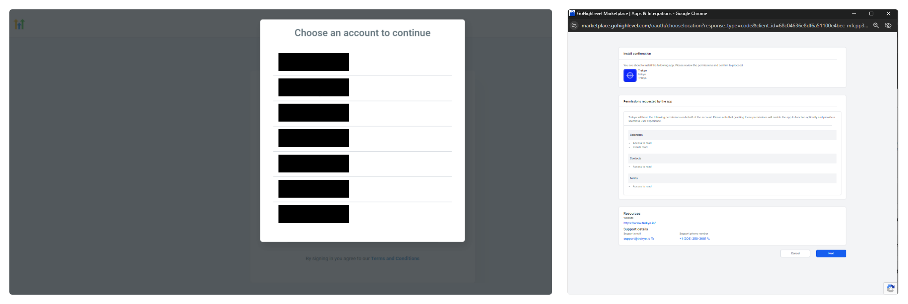

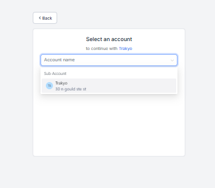

---

## Form

Every form that should feed **Trakyo** needs one hidden field carrying the visitor id — the
fingerprint — and one workflow that sends the submission over with the `trakyo_id`.

### Form configuration

In GoHighLevel, click **Sites** in the left sidebar and click **Forms** in the top
navigation to start:

#### Option A: you do not have a form yet

1. Click **+ Add Form**.
2. Choose **Start from Scratch**.
3. Add your standard fields: First Name, Last Name, Email, Phone.
4. Click **Add**, choose **Custom Fields**, and pick **Single Line** as the field type.
5. Fill the field settings in exactly — they are case-sensitive:

:::note
Name = `trakyo_id`
Object = `Contact`
Group = `Contact`
Placeholder = `trakyo_id`
Prefill = `trakyo_id`
Unique Key = `contact.trakyo_id`
:::

6. Click the `trakyo_id` field, tick **Hidden**, and set the Hidden Value to `trakyo_id`.

#### Option B: you already have a form

1. Select the form you want to configure.
2. Click **Add**, choose **Custom Fields**, and pick **Single Line** as the field type.
3. Fill in the same settings as above, exactly.
4. Click the `trakyo_id` field, tick **Hidden**, and set the Hidden Value to `trakyo_id`.

### Form workflow automation setup

1. Go to **Automation** → **Workflows** to start.
2. Click **Create Workflow**, then **Add Trigger** → **Form Submitted**.
3. Under **Filters**, click **Add Filters** and choose the forms to track. Leave it empty
   and every form is tracked.

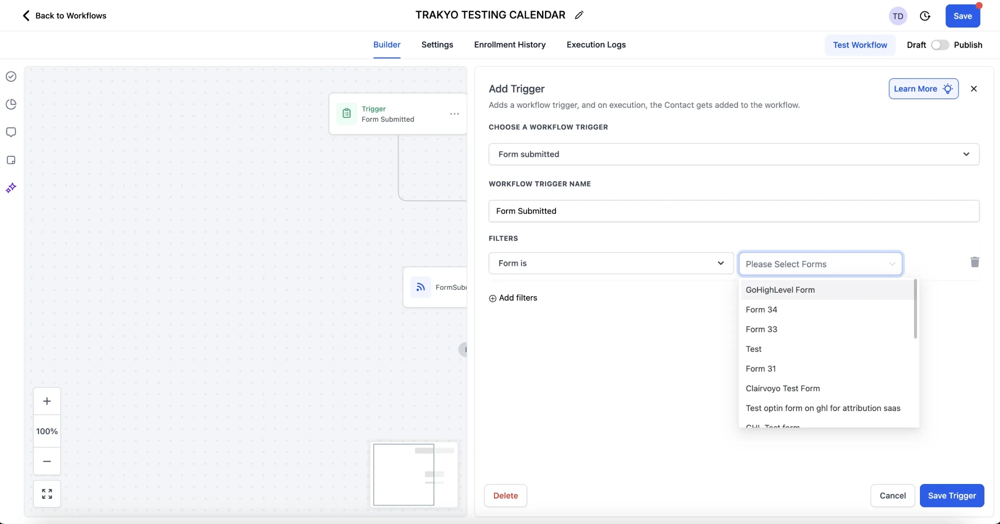

4. Click **+** below the trigger and select **Webhook**.
5. Configure it as follows:
   1. Action Name = `Form Submitted to Trakyo`
   2. Webhook URL = `https://app.trakyo.io/api/platforms/ghlevel/webhook`
   3. Method = `POST`
   4. Custom Data Field (key) = `type`
   5. Custom Data Field (value) = `FormCreate`

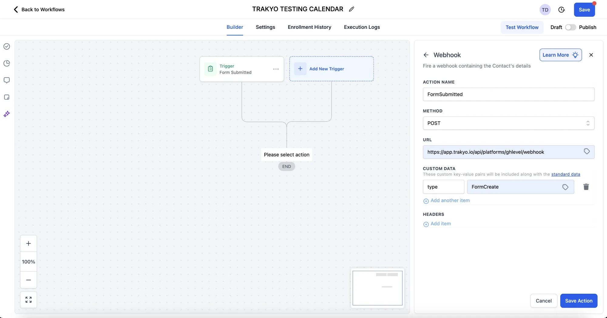

6. Toggle the workflow from **Draft** to public, and click **Save**.

:::tip
One workflow can carry all of them. Open a workflow, click **Add New Trigger** next to the
existing trigger, and add **Survey Submitted** or **Quiz Submitted**. Every trigger fires
independently and they all share the same webhook, so there is nothing else to change.
:::

---

## Survey

A survey is tracked the same way as a form: the `trakyo_id` field first, then its own
workflow. Only the trigger changes.

### Survey configuration

Add the `trakyo_id` custom field to the survey exactly as in
[Form configuration](#form-configuration) — the same six settings, hidden, with the Hidden
Value `trakyo_id`.

### Survey workflow automation setup

1. Go to **Automation** → **Workflows** to start.
2. Click **Create Workflow**, then **Add Trigger** → **Survey Submitted**.
3. Under **Filters**, choose **Survey is** and pick the surveys to track. Leave it empty and
   every survey is tracked.

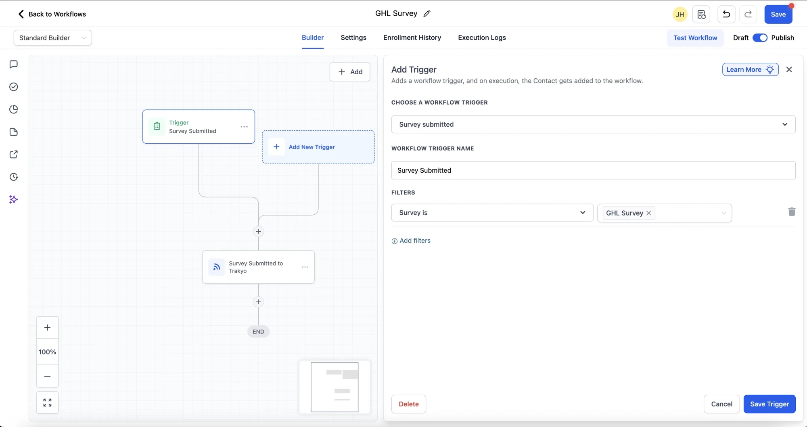

4. Click **+** below the trigger and select **Webhook**.
5. Configure it as follows:
   1. Action Name = `Survey Submitted to Trakyo`
   2. Webhook URL = `https://app.trakyo.io/api/platforms/ghlevel/webhook`
   3. Method = `POST`
   4. Custom Data Field (key) = `type`
   5. Custom Data Field (value) = `FormCreate`

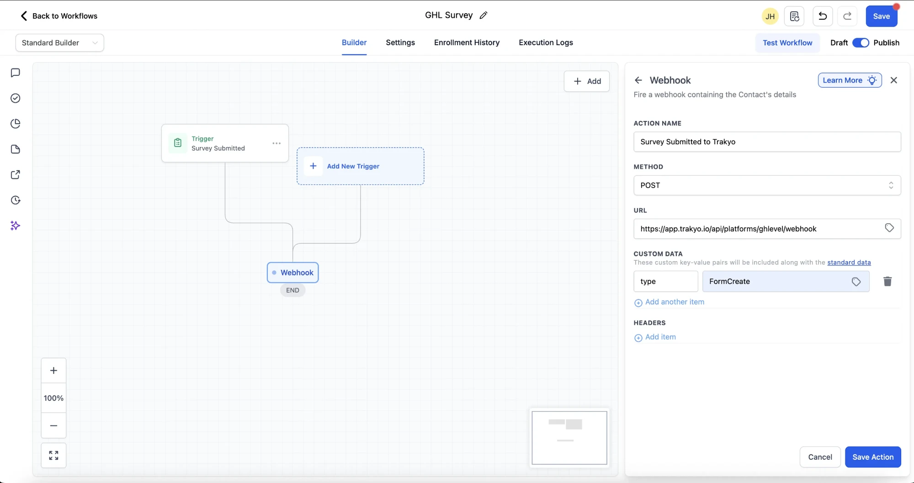

6. Toggle the workflow from **Draft** to public, and click **Save**.

---

## Quiz

A quiz is tracked the same way: the `trakyo_id` field first, then its own workflow. Only
the trigger changes.

### Quiz configuration

Add the `trakyo_id` custom field to the quiz exactly as in
[Form configuration](#form-configuration) — the same six settings, hidden, with the Hidden
Value `trakyo_id`.

### Quiz workflow automation setup

1. Go to **Automation** → **Workflows** to start.
2. Click **Create Workflow**, then **Add Trigger** → **Quiz Submitted**.
3. Under **Filters**, choose **Quiz Name**, then **Is**, and pick the quiz to track.

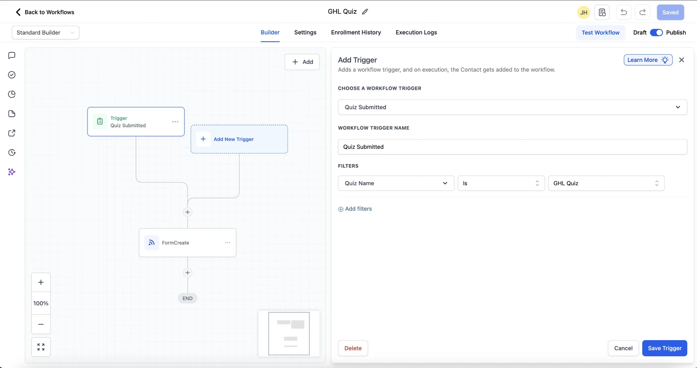

4. Click **+** below the trigger and select **Webhook**.
5. Configure it as follows:
   1. Action Name = `Quiz Submitted to Trakyo`
   2. Webhook URL = `https://app.trakyo.io/api/platforms/ghlevel/webhook`
   3. Method = `POST`
   4. Custom Data Field (key) = `type`
   5. Custom Data Field (value) = `FormCreate`

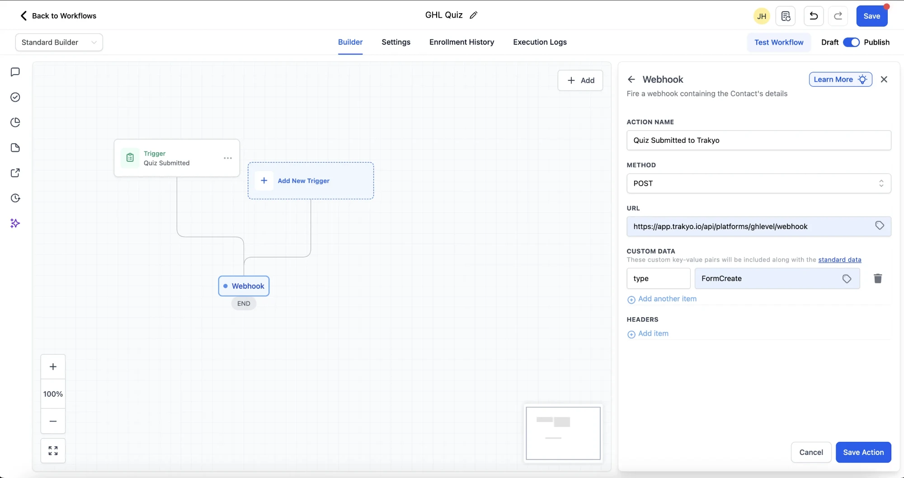

6. Toggle the workflow from **Draft** to public, and click **Save**.

---

## Calendar

:::warning
To track bookings, the `trakyo_id` hidden field has to be on the form your calendar uses.
Custom fields can only be added to custom forms, so a calendar's default form cannot be
tracked. If your calendar uses the default form, recreate it as a custom form with the
same fields plus the `trakyo_id` field. Without that, calls are not attributed properly.
:::

### Calendar configuration

Start by finding out which form your calendar uses. Go to **Calendars** in the left
sidebar and choose **Calendar settings** at the top.

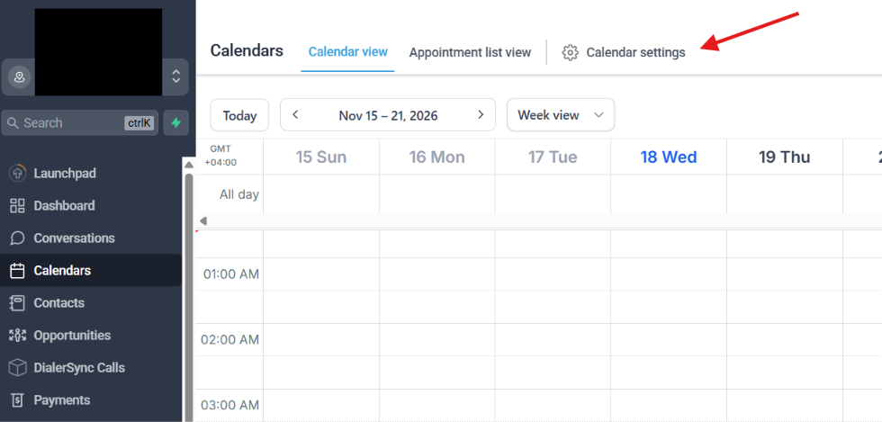

Find your calendar and click the pencil icon to edit it, then open **Advanced settings** →
**Form & confirmation**.

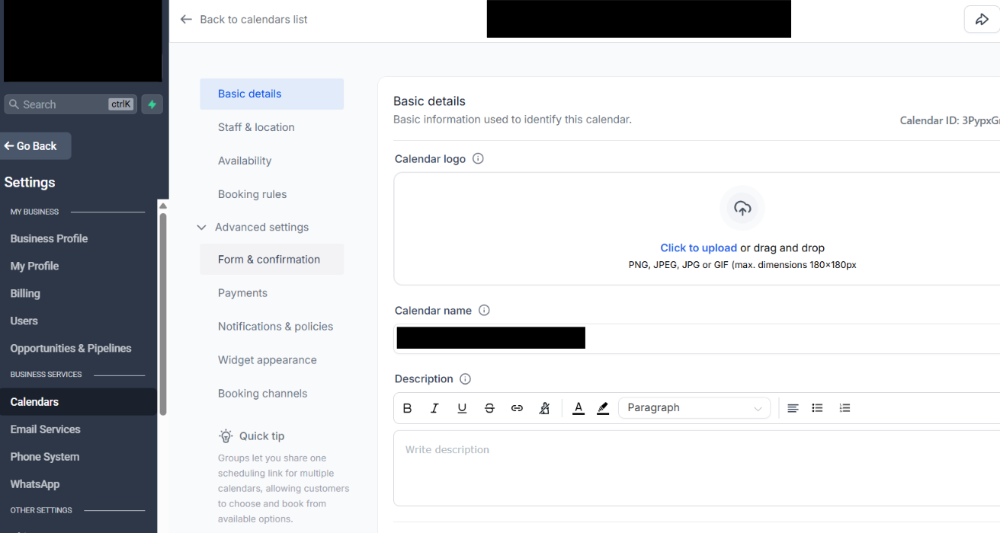

Look at **Select form**. If the default form is assigned, either choose another custom
form, or go back to **Sites** → **Forms** and create one.

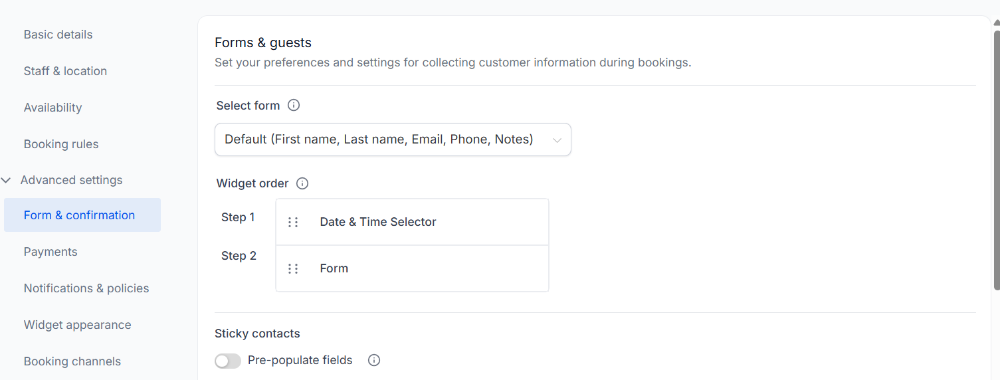

Once you know which form it is, add the `trakyo_id` field to it as described in
[Form configuration](#form-configuration), then come back here for the workflow.

### Calendar workflow automation setup

1. Go to **Workflows** and click **Create Workflow**.
2. Click **Add Trigger** and select **Customer Booked Appointment**.
3. Add the filter **In calendar** and choose your calendar. GoHighLevel does not allow
   more than one calendar per filter, so to track several, add one trigger per calendar and
   choose a different calendar in each.

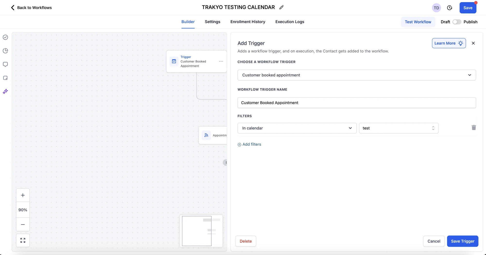

4. Click **+** below the trigger and select **Webhook**.
5. Configure it as follows:
   1. Action Name = `Appointment Booked to Trakyo`
   2. Webhook URL = `https://app.trakyo.io/api/platforms/ghlevel/webhook`
   3. Method = `POST`
   4. Custom Data Field (key) = `type`
   5. Custom Data Field (value) = `AppointmentCreate`

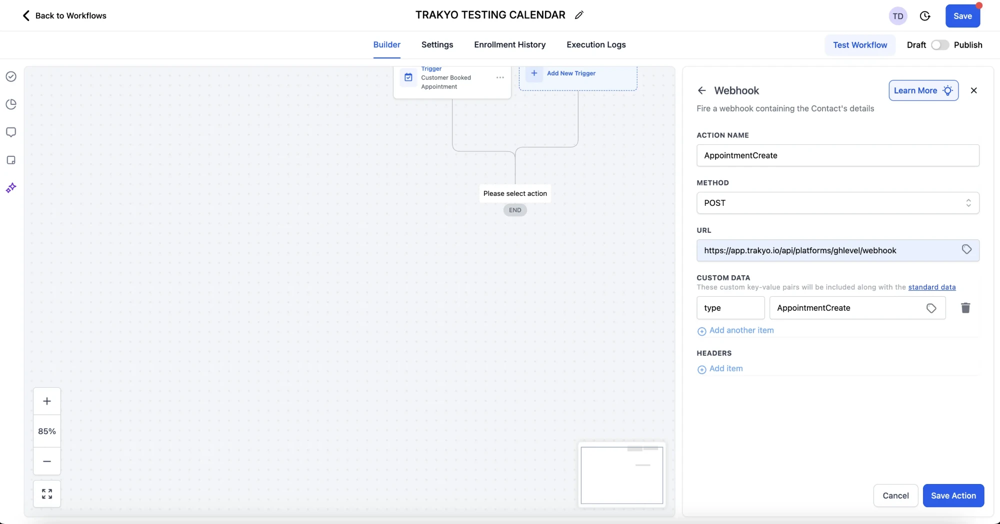

6. Toggle the workflow from **Draft** to public, and click **Save**.

:::tip
To track a lead when your sales team confirms the call rather than when it is booked,
choose the **Appointment status** trigger and set the filter **Appointment status is** to
`confirmed`.

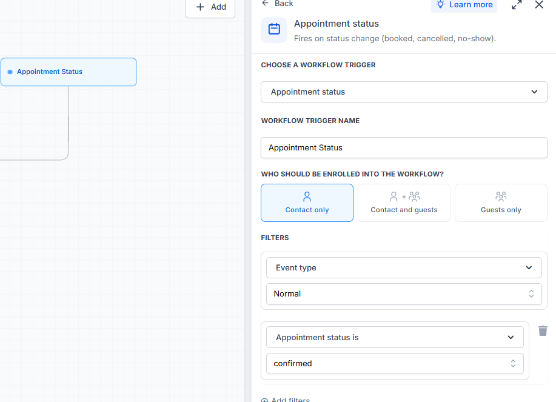
:::

---

## Test the integration

Here is how to double-check that everything is connected properly.

1. Click any tracking link that leads to your form application, survey, quiz or calendar.
   If you do not have one yet, create a tracking link so you can run a test.
2. Once the page opens, check that `trakyo_id` appears in the URL as a parameter.
3. Fill the form, survey or quiz in, and watch that `trakyo_id` is carried forward to the
   next page — the calendar, if booking a call is the last step. If it is not carried
   forward, your page builder has to be configured to pass the `trakyo_id` URL parameter on.
4. Finish the test: fill everything in and book a call.
5. Open **[Leads](https://app.trakyo.io/leads)** in **Trakyo** and look for your test lead.
   With a long list, search for the email address you entered on the form.
6. Open the lead and check that it shows everything you filled in, along with its
   attribution.

If all of that shows up, your integration is configured properly.

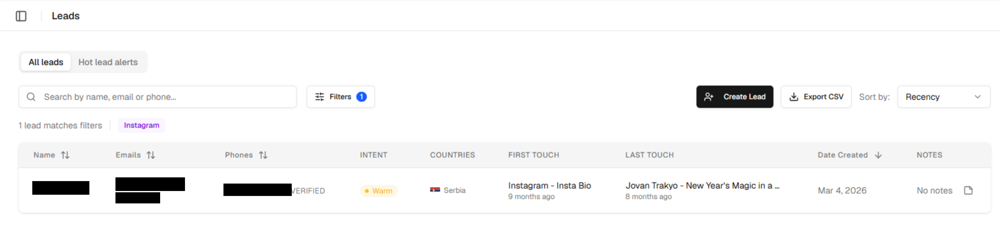

:::tip
Even with this integration live, create a Custom Tracking content item for any form you
share directly with leads. That is what lets you see the attribution for that specific
placement, rather than just the submission.
:::

:::info
Learn more about the [Leads page](/docs/help/leads/overview) here.
:::
