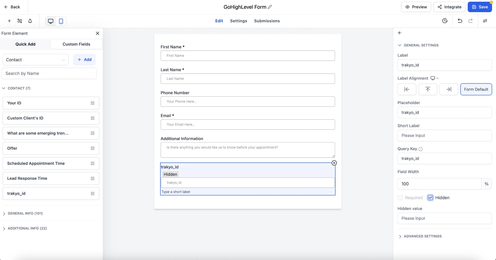

The **Trakyo** integration with GoHighLevel tracks the leads who fill in your form
applications, surveys and quizzes, and who book calls on your GHL calendars.

:::tip
This article covers the GHL integration itself:

- tracking forms,
- surveys,
- quizzes and
- schedulers.

It does not cover configuring your GoHighLevel funnels, or adding the tracking script to
pages built on GHL — that is in the Custom Domains article.
:::

---

## Connect GHL with Trakyo

Open the **[Integrations](https://app.trakyo.io/integrations)** page in **Trakyo** and find
the GoHighLevel card to start.

1. Click **Connect**.
2. Log in to your GoHighLevel account.
3. Select the GHL account or sub-account you want to connect.
4. Click **Connect to GoHighLevel** to finish.

_[Screenshot: the GoHighLevel Forms Integration window, step 1]_

---

## Forms - configuration and workflow automation setup

Every form that should feed **Trakyo** needs one hidden field carrying the visitor id — the
fingerprint — and one workflow that sends the submission over with the `trakyo_id`.

### Form configuration

In GoHighLevel, click **Sites** in the left sidebar and click **Forms** in the top
navigation to start:

#### Option A: you do not have a form yet

1. Click **+ Add Form**.
2. Choose **Start from Scratch**.
3. Add your standard fields: First Name, Last Name, Email, Phone.
4. Click **Add**, choose **Custom Fields**, and pick **Single Line** as the field type.
5. Fill the field settings in exactly — they are case-sensitive:

:::note
Name = `trakyo_id`
Object = `Contact`
Group = `Contact`
Placeholder = `trakyo_id`
Prefill = `trakyo_id`
Unique Key = `contact.trakyo_id`
:::

6. Click the `trakyo_id` field, tick **Hidden**, and set the Hidden Value to `trakyo_id`.

#### Option B: you already have a form

1. Select the form you want to configure.
2. Click **Add**, choose **Custom Fields**, and pick **Single Line** as the field type.
3. Fill in the same settings as above, exactly.
4. Click the `trakyo_id` field, tick **Hidden**, and set the Hidden Value to `trakyo_id`.

:::tip
Schedulers are tracked through a form too. A calendar has to have a custom form assigned to
it, built exactly as above, so the `trakyo_id` field travels with the booking.
:::

### Form workflow automation setup

1. Go to **Automation** → **Workflows** to start.
2. Click **Create Workflow**, then **Add Trigger** → **Form Submitted**.
3. Under **Filters**, click **Add Filters** and choose the forms to track. Leave it empty
   and every form is tracked.
4. Click **+** below the trigger and select **Webhook**.
5. Configure it as follows:
   1. Action Name = `Form Submitted to Trakyo`
   2. Webhook URL = `https://app.trakyo.io/api/platforms/ghlevel/webhook`
   3. Method = `POST`
   4. Custom Data Field (key) = `type`
   5. Custom Data Field (value) = `FormCreate`
6. Toggle the workflow from **Draft** to public, and click **Save**.

_[Screenshot: the webhook action settings]_

:::tip
One workflow can carry all four. Open a workflow, click **Add New Trigger** next to the
existing trigger, and add **Survey Submitted** or **Quiz Submitted**. Every trigger fires
independently and they all share the same webhook, so there is nothing else to change.
:::

---

## Survey - configuration and workflow automation setup

1. Go to **Automation** → **Workflows** and click **Create Workflow**.
2. Click **Add Trigger** and select **Survey Submitted**.
3. Click **+** below the trigger and select **Webhook**.
4. Configure it:

:::note
Action Name = `Survey Submitted to Trakyo`
Webhook URL = `https://app.trakyo.io/api/platforms/ghlevel/webhook`
Method = `POST`
Custom Data Field (key) = `type`
Custom Data Field (value) = `FormCreate`
:::

5. Under **Filters**, choose which surveys to track, or leave it empty for all of them.
6. Toggle to public and click **Save**.

---

## Quiz - configuration and workflow automation setup

1. Go to **Automation** → **Workflows** and click **Create Workflow**.
2. Click **Add Trigger**, select **Quiz Submitted**, and pick the quiz under **Filters**.
3. Click **+** below the trigger and select **Webhook**.
4. Configure it:

:::note
Action Name = `Survey Submitted to Trakyo`
Webhook URL = `https://app.trakyo.io/api/platforms/ghlevel/webhook`
Method = `POST`
Custom Data Field (key) = `type`
Custom Data Field (value) = `FormCreate`
:::

5. Toggle to public and click **Save**.

---

## Calendar - configuration and workflow automation setup

:::danger
Set your forms up first. Calendars have to be linked to a form that carries the `trakyo_id`
field, or bookings arrive with no attribution.
:::

1. Go to **Workflows** and click **Create Workflow**.
2. Click **Add Trigger** and select **Customer Booked Appointment**.
3. Click **+** below the trigger and select **Webhook**.
4. Configure it:

:::note
Action Name = `Appointment Booked to Trakyo`
Webhook URL = `https://app.trakyo.io/api/platforms/ghlevel/webhook`
Method = `POST`
Custom Data Field (key) = `type`
Custom Data Field (value) = `AppointmentCreate`
:::

5. Under **Filters**, click **Add Filters** and choose the calendar to track. Leave it empty
   and every calendar is tracked.
6. Tracking more than one calendar? Add another **Customer Booked Appointment** trigger per
   calendar, each with its own filter.
7. Toggle to public and click **Save**.
8. In **Settings** → **Business Profile**, fill in your business details. They appear on
   calendar bookings.
9. In **Settings** → **Calendars**, open the calendar and click **Edit Calendar**.
10. In the **Forms** section, select the form you built above — the one with the
    `trakyo_id` field.

_[Screenshot: the calendar webhook settings]_

---

## Check it worked

Submit one of your own forms, then open **[Leads](https://app.trakyo.io/leads)**. The
submission should appear as a new lead within a minute, and opening it should show the
click that brought that person in.

:::info
Even with this integration live, create a Custom Tracking content item for any form you
share directly with leads. That is what lets you see the attribution for that specific
placement, rather than just the submission.
:::
