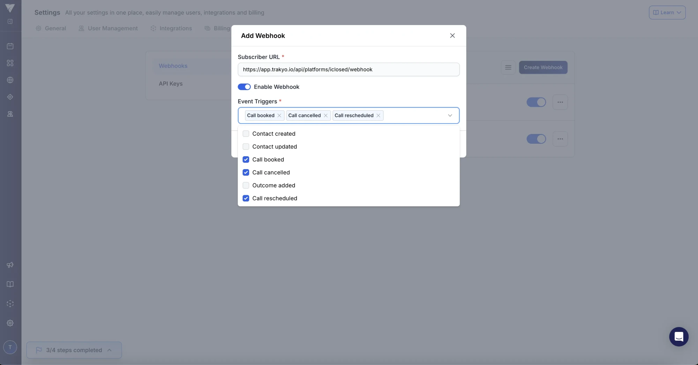

The **Trakyo** integration with iClosed tracks the calls booked through iClosed and
attributes each booking to the content that produced it. There are two ways to connect: the
iClosed webhook, or Zapier or Make through Custom Booking.

---

## Connect with the iClosed webhook

:::warning
Webhook access is not on by default. Email iClosed support to have it turned on for your
account, then manage it in your
**[iClosed developer settings](https://app.iclosed.io/app/settings/developer)**.
:::

### Add the emails to track

Open the **[Integrations](https://app.trakyo.io/integrations)** page in **Trakyo**, find the
iClosed card, and add the host email of every closer whose bookings you want tracked. Click
**Save Emails**.

:::warning
Use each closer's iClosed login email, not the address they connected their calendar with.
Save the emails before you create the webhook in iClosed, too — **Trakyo** uses the closer's
email to route each booking to your account. When you add a closer in iClosed later,
remember to add them here as well.
:::

### Create the webhook in iClosed

1. In iClosed, go to **Settings** → **Developer** → **Webhooks**.
2. Click **Create Webhook** and paste the webhook URL from the iClosed card in **Trakyo**
   as the **Subscriber URL**. It is unique to your account, so copy it from there rather
   than from anywhere else.
3. Under **Event Triggers**, choose the events to send.

4. Save the webhook.

:::tip
Send **Call booked** only. The other triggers add events that do not change what **Trakyo**
reports.
:::

### Add your event slugs

Event filters are optional. Leave them empty and every iClosed event is tracked; add slugs
and only those events are.

To find a slug:

1. Open **Events** in your iClosed dashboard.
2. Click the event you want to track.
3. Read the last part of the URL, after the final slash. In
   `https://app.iclosed.com/events/trakyo-event` the slug is `trakyo-event`.

Add each slug on the iClosed card in **Trakyo** and click **Save Event Filters**.

---

## Connect through Zapier or Make

The other route is to send iClosed bookings to the webhook in
**[Custom Booking](/docs/help/integrations/custom-booking)** with a Zapier or Make
automation. It gives you more control over which events you send, and you do not have to
list your closers' emails.

:::warning
Zapier's **Webhooks by Zapier** is only on its paid plans, Professional or higher. A free
trial includes it, but the Zaps stop working when the trial ends. Check your plan under
**[Zapier settings → Billing](https://zapier.com/app/settings/billing)**.
:::

Follow the steps in **[Custom Booking](/docs/help/integrations/custom-booking)**, with your
iClosed booking as the trigger.

---

## Capture the leads who did not book

Leads who start your iClosed form but never book a call can reach **Trakyo** too, through
the webhook in **[Custom Form](/docs/help/integrations/custom-form)** and a Zapier
automation.

iClosed gives each lead a status as they move through the scheduling form:

- **Potential** — they dropped off the form before pressing **Continue**.
- **Qualified** — they filled the form in and pressed **Continue**, but did not book.
- **Disqualified** — they filled the form in and pressed **Continue**, but the event's
  disqualification criteria stopped them booking.
- **Call booked** — the last step of the journey.

### Set up the Zap

1. Open the **[Integrations](https://app.trakyo.io/integrations)** page in **Trakyo**, find
   the Custom Form card, and copy its webhook URL.
2. In Zapier, create a Zap with the iClosed trigger **Contact by status**, configured as:
   - **Status** — Strategy call booked
   - **Delay** — 300 to 600 seconds
   - **Send last active status** — Yes
3. Add a path for each status you want to capture, filtering on **Status** → **exactly
   matches** → `Potential`, `Qualified` or `Disqualified`.
4. In every path, add **Webhooks by Zapier** with **POST** as the action event. Paste the
   Custom Form webhook URL, and choose **Json** as the payload type.
5. Map these fields in each path:

| Field | Value |
| --- | --- |
| `email` | iClosed **Email** |
| `name` | iClosed **First name** and **Last name**, which are two separate fields |
| `phone` | iClosed **Phone** |
| `trakyo_id` | iClosed **UTM Term** |
| `form_name` | a name of your own, such as `iClosed - Potential`. It is what you see on the lead's journey in **Trakyo** |

6. Publish the Zap.

:::tip
The delay is what makes this work. Waiting 300 to 600 seconds gives a lead time to finish
the form, and **Send last active status** means that if they never book, **Trakyo** still
gets the status they reached.
:::

### Test it

Open your iClosed scheduler through a **Trakyo** tracking link, fill the form in, do not
book, and close the tab. Wait for the delay to pass, then open
**[Leads](https://app.trakyo.io/leads)** — the person is there as a qualified lead.

---

## Test the integration

1. Book a call on a tracked event, with one of the closers you listed.
2. Open **[Leads](https://app.trakyo.io/leads)** in **Trakyo** and check the booking is
   listed against that person, with the content that brought them in.

---

:::info
Learn more about the **[Leads page](/docs/help/leads/overview)** here.
:::
