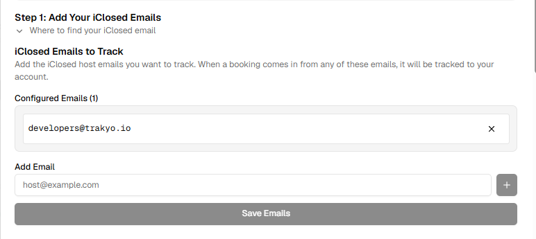
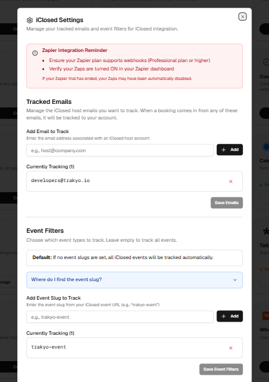

The **Trakyo** integration with iClosed tracks the calls booked through iClosed and
attributes each booking to the content that produced it. There are two ways to connect: the
iClosed webhook, or Zapier or Make through Custom Booking.

---

## Connect with the iClosed webhook

:::warning
Webhook access is not on by default. Email iClosed support to have it turned on for your
account, then manage it in your
**[iClosed developer settings](https://app.iclosed.io/app/settings/developer)**.
:::

### Add the emails to track

Open the **[Integrations](https://app.trakyo.io/integrations)** page in **Trakyo**, find the
iClosed card, and add the host email of every closer whose bookings you want tracked. Click
**Save Emails**.

:::warning
Use each closer's iClosed login email, not the address they connected their calendar with.
Save the emails before you create the webhook in iClosed, too — **Trakyo** uses the closer's
email to route each booking to your account.
:::

### Create the webhook in iClosed

1. In iClosed, go to **Settings** → **Developer** → **Webhooks**.
2. Click **Create Webhook** and paste the webhook URL from the iClosed card in **Trakyo**
   as the **Subscriber URL**. It is unique to your account, so copy it from there rather
   than from anywhere else.
3. Under **Event Triggers**, choose the events to send.

4. Save the webhook.

:::tip
Send **Call booked** only. The other triggers add events that do not change what **Trakyo**
reports.
:::

### Add your event slugs

Event filters are optional. Leave them empty and every iClosed event is tracked; add slugs
and only those events are.

To find a slug:

1. Open **Events** in your iClosed dashboard.
2. Click the event you want to track.
3. Read the last part of the URL, after the final slash. In
   `https://app.iclosed.com/events/trakyo-event` the slug is `trakyo-event`.

Add each slug on the iClosed card in **Trakyo** and click **Save Event Filters**.

---

## Connect through Zapier or Make

The other route is to send iClosed bookings to the webhook in
**[Custom Booking](/docs/help/integrations/custom-booking)** with a Zapier or Make
automation. It gives you more control over which events you send, and you do not have to
list your closers' emails.

:::warning
Zapier's **Webhooks by Zapier** is only on its paid plans, Professional or higher. A free
trial includes it, but the Zaps stop working when the trial ends. Check your plan under
**[Zapier settings → Billing](https://zapier.com/app/settings/billing)**.
:::

Follow the steps in **[Custom Booking](/docs/help/integrations/custom-booking)**, with your
iClosed booking as the trigger.

---

## Test the integration

1. Book a call on a tracked event, with one of the closers you listed.
2. Open **[Leads](https://app.trakyo.io/leads)** in **Trakyo** and check the booking is
   listed against that person, with the content that brought them in.

---

:::info
Learn more about the **[Leads page](/docs/help/leads/overview)** here.
:::
