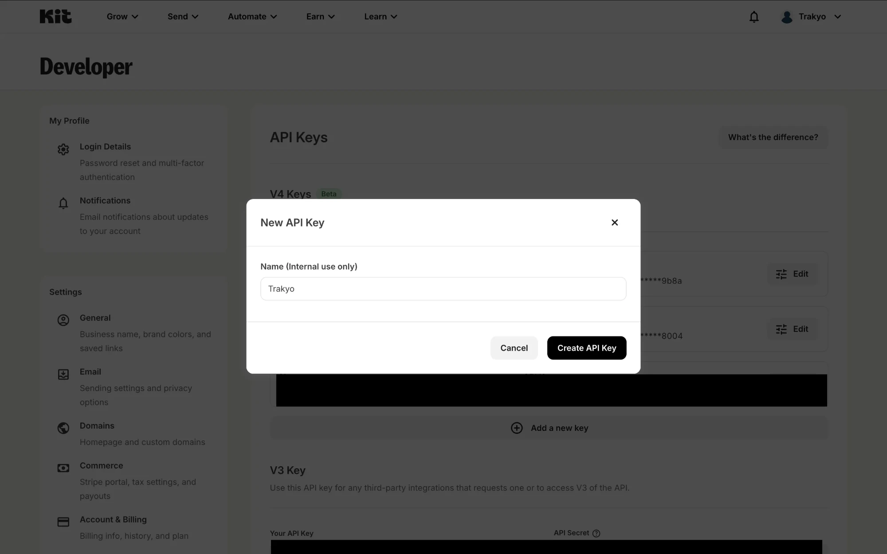
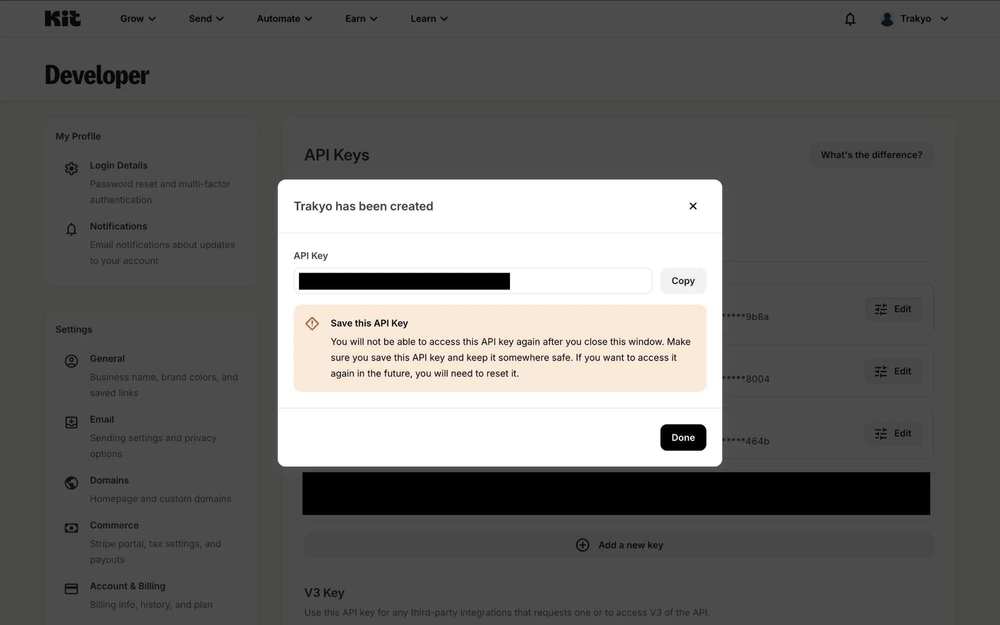
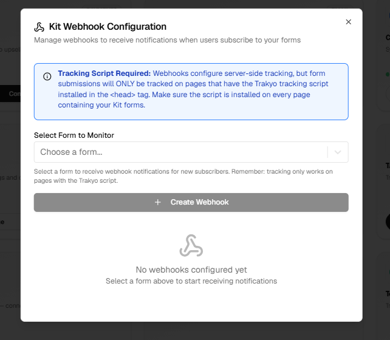

The **Trakyo** integration with Kit tracks the email submissions from your Kit forms and
attributes each one to the content that brought the subscriber in.

:::warning[Tracking script required]
The webhook does its work server-side, but a submission is only tracked on a page that has
the **Trakyo** tracking script in its `<head>` tag. Install the script on every page that
holds a Kit form.
:::

---

## Connect your Kit account

1. In Kit, open **Settings** → **Developer**.

2. Under **API Keys**, go to **V4 Keys** and click **Add a new key**.

:::warning
It has to be a V4 key. The V3 key further down the page does not work with **Trakyo**.
:::

3. Name it `Trakyo` and click **Create API Key**.

4. Copy the key.

:::warning
Kit shows the key once. Copy it before you close that window — to see it again you have to
reset it.
:::

5. Open the **[Integrations](https://app.trakyo.io/integrations)** page in **Trakyo**, find
   the Kit card, paste the key in and click connect.

:::tip
Connecting Kit gives you:

- automatic tracking of form submissions,
- subscriber data and custom fields,
- tag additions and purchases,
- conversions attributed by UTM parameters.
:::

---

## Create a webhook for each form

**Trakyo** tracks the forms you choose, one webhook per form. On the Kit card, pick a form
under **Select Form to Monitor** and click **Create Webhook**. Repeat for every form you
want tracked.

---

## Add the Trakyo ID field to your forms

Each form also needs a hidden field that carries the visitor's Trakyo id, so a submission
can be tied to the visit that produced it.

### Create the custom field

1. In Kit, open **Subscribers** and click any subscriber to open their details.
2. Click **Add field**.
3. Name it `Trakyo ID` and click **Save**.

### Add it to the form

1. Go to **Landing Pages & Forms** and open the form you want to track, or create one.
2. In the **Custom Field** section, open the dropdown and choose **Trakyo ID**.
3. Set the **Custom field label** to exactly `trakyo_id` — lowercase, with an underscore —
   and leave **Required** unchecked.
4. In the **Custom CSS** section, paste the CSS from the Kit card in **Trakyo**. It hides the
   field, so your subscribers never see it.
5. Click **Publish**.
6. Click **Embed** and copy the code for your site — JavaScript or HTML, whichever suits your
   site builder.

:::note
The label has to be `trakyo_id` exactly. Any other spelling and the id does not reach
**Trakyo**.
:::

---

## Test the integration

1. Open a page that holds your Kit form, and check the **Trakyo** script is in its `<head>`.
2. Submit the form with a test email address.
3. Open **[Leads](https://app.trakyo.io/leads)** in **Trakyo** and check the submission is
   listed, with the content that brought the visitor in.

---

:::info
Learn more about the **[Leads page](/docs/help/leads/overview)** here.
:::
