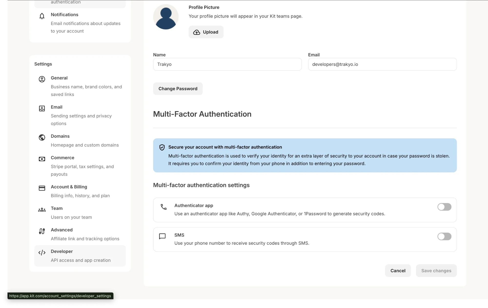
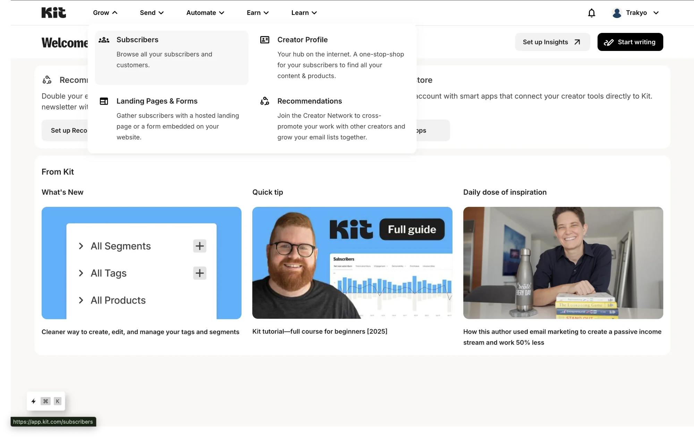
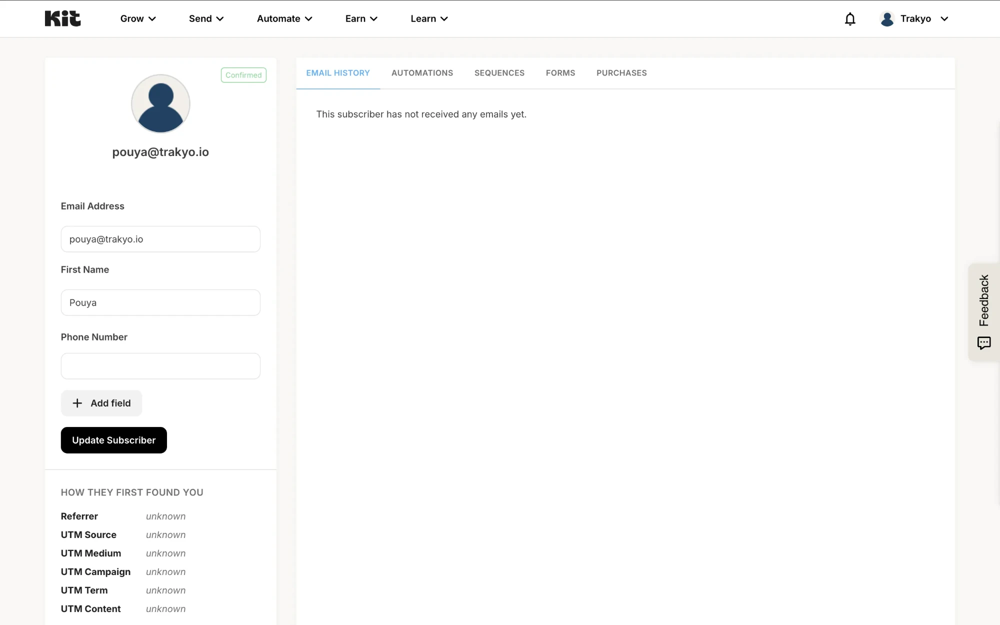
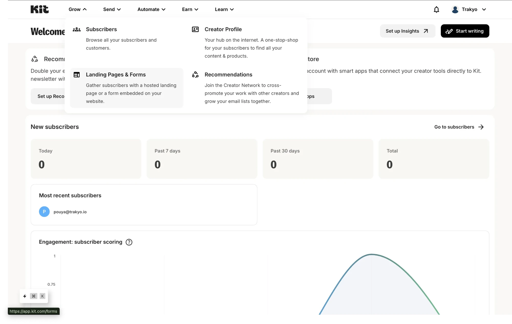
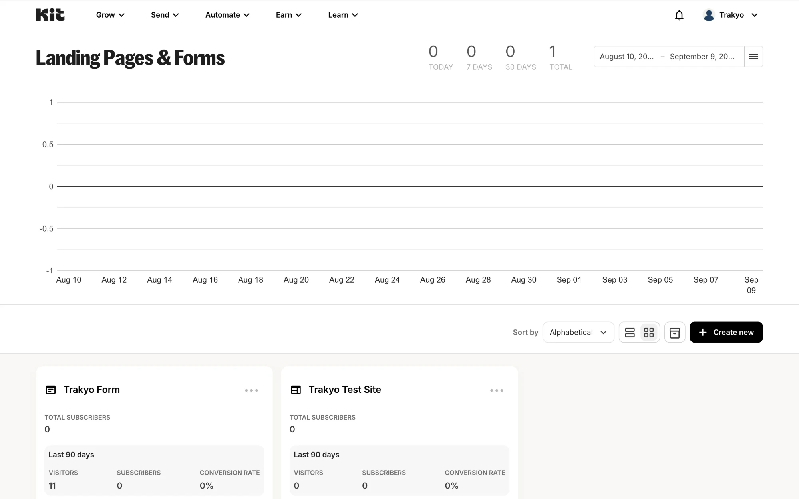
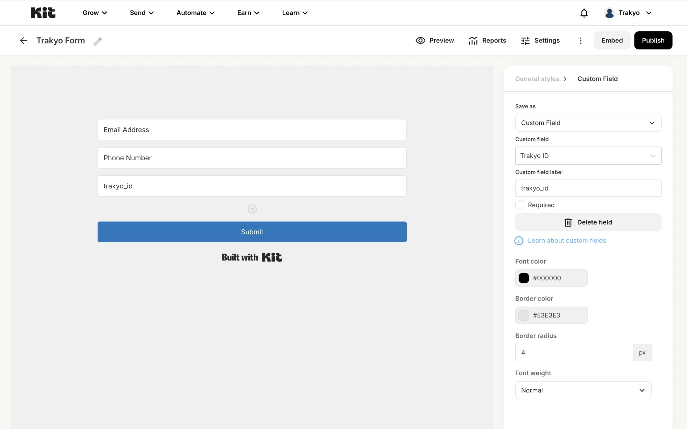
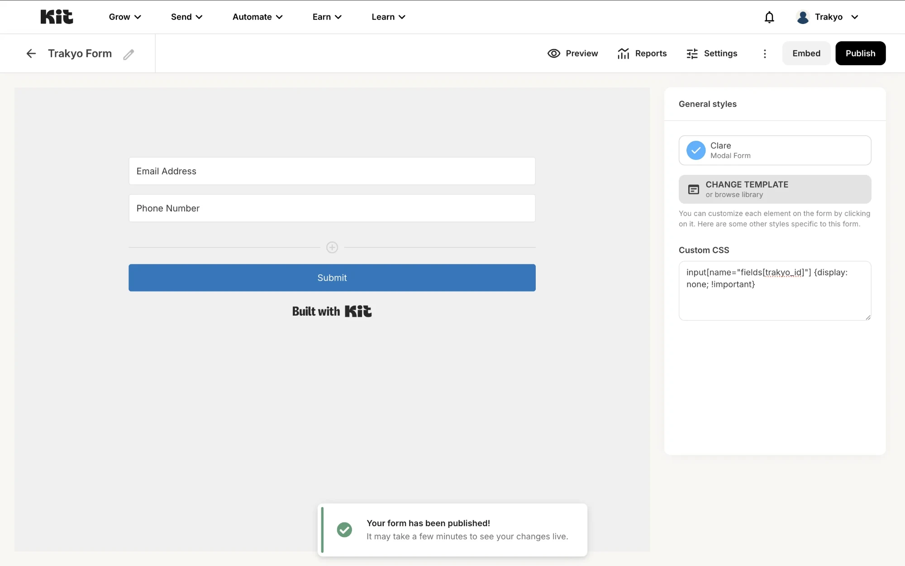
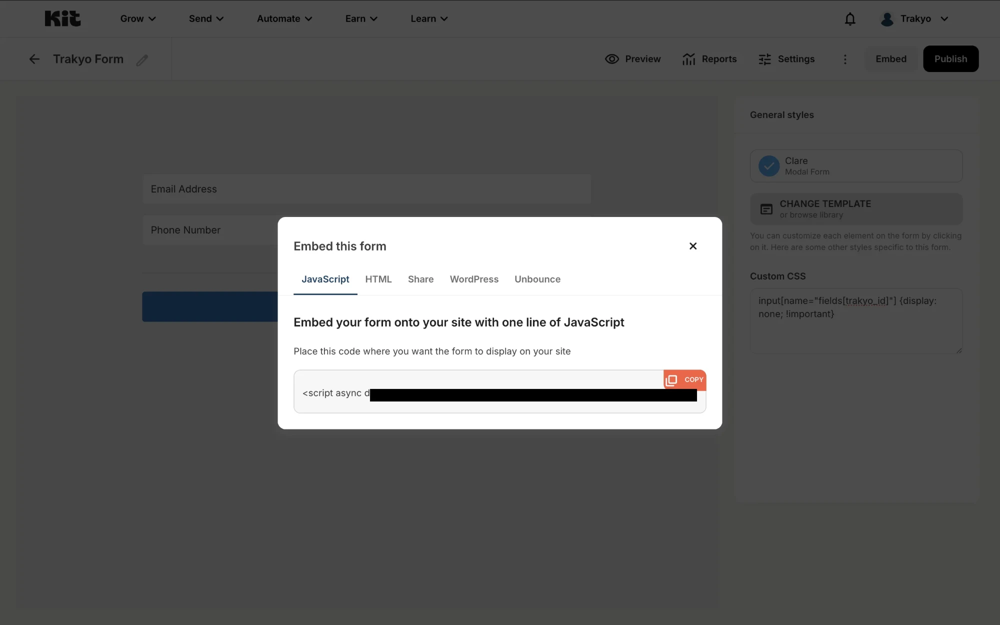
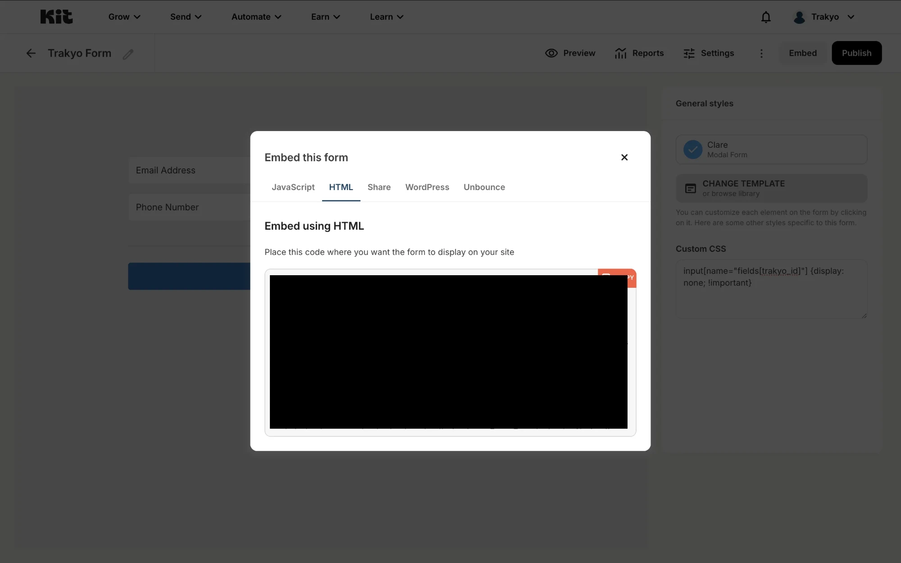

The **Trakyo** integration with Kit tracks the email submissions from your Kit forms and
attributes each one to the content that brought the subscriber in.


:::warning[Tracking script required]
The webhook does its work server-side, but a submission is only tracked on a page that has
the **Trakyo** tracking script in its `<head>` tag. Install the script on every page that
holds a Kit form.
:::

If you do not collect subscribers through Kit forms, and only want to track the emails you
send from Kit, you do not need this integration at all. Create tracking links in
**[Custom Tracking](https://app.trakyo.io/custom-tracking)** instead, one for each link your
readers click.

---

## Connect your Kit account

1. In Kit, open **Settings** → **Developer**.



2. Under **API Keys**, go to **V4 Keys** and click **Add a new key**.

:::warning
It has to be a V4 key. The V3 key further down the page does not work with **Trakyo**.
:::

3. Name it `Trakyo` and click **Create API Key**.


4. Copy the key.


:::warning
Kit shows the key once. Copy it before you close that window — to see it again you have to
reset it.
:::

5. Open the **[Integrations](https://app.trakyo.io/integrations)** page in **Trakyo**, find
   the Kit card, paste the key in and click connect.

:::tip
Connecting Kit gives you:

- automatic tracking of form submissions,
- subscriber data and custom fields,
- tag additions and purchases,
- conversions attributed by UTM parameters.
:::

---

## Add the Trakyo ID field to your forms

Each form also needs a hidden field that carries the visitor's Trakyo id, so a submission
can be tied to the visit that produced it.

### Create the custom field

1. In Kit, open **Grow** → **Subscribers**.



2. Click any subscriber to open their details, then click **Add field**.



3. Name it `Trakyo ID` and click **Save**.

### Add it to the form

1. Open **Grow** → **Landing Pages & Forms**.



2. Open the form you want to track, or click **Create new**.



3. In the **Custom Field** section, open the dropdown and choose **Trakyo ID**.


4. Set the **Custom field label** to exactly `trakyo_id` — lowercase, with an underscore —
   and leave **Required** unchecked.



5. In the **Custom CSS** section, paste this. It hides the field, so your subscribers never
   see it:

   ```css
   input[name="fields[trakyo_id]"] {display: none !important;}
   ```

6. Click **Publish**.



7. Click **Embed** and copy the code for your site. The **JavaScript** tab gives you one
   line to paste; the **HTML** tab gives you the form's full markup, if your site builder
   needs that instead.





:::note
The label has to be `trakyo_id` exactly. Any other spelling and the id does not reach
**Trakyo**.
:::

---

## Create a webhook for each form

With the field in place, the last step is telling **Trakyo** which forms to watch — one
webhook per form. On the Kit card, pick a form under **Select Form to Monitor** and click
**Create Webhook**. Repeat for every form you want tracked.


---

## Test the integration

1. Open a page that holds your Kit form, and check the **Trakyo** script is in its `<head>`.
2. Submit the form with a test email address.
3. Open **[Leads](https://app.trakyo.io/leads)** in **Trakyo** and check the submission is
   listed, with the content that brought the visitor in.

---

:::info
Learn more about the **[Leads page](/docs/help/leads/overview)** here.
:::
