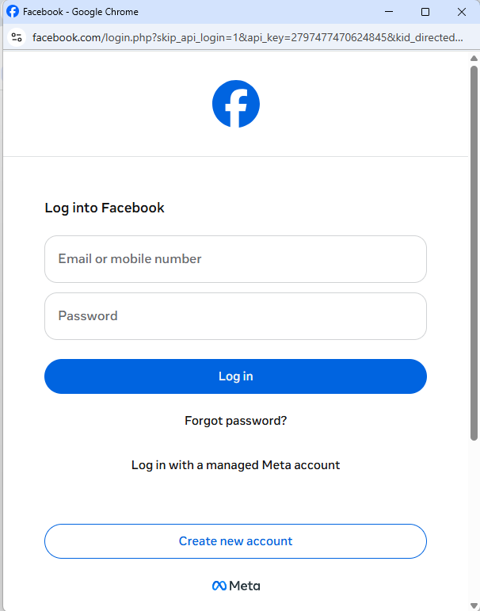
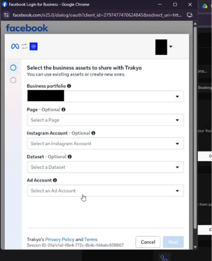
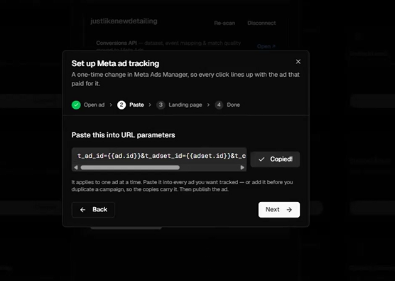
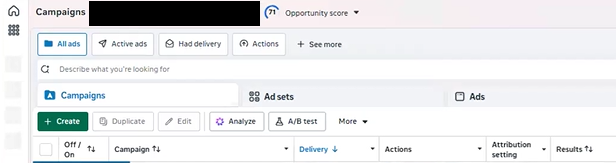
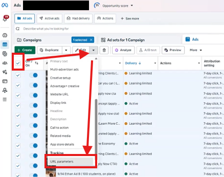
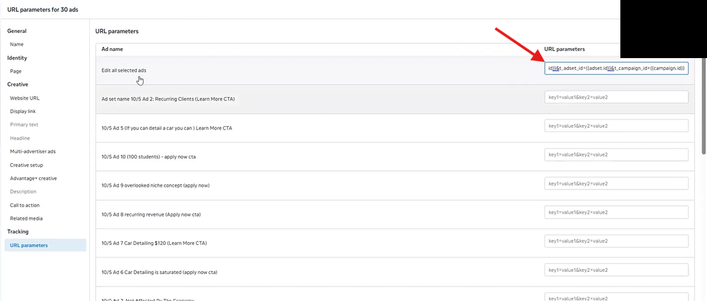

The **Trakyo** integration with Meta Ads attributes leads and sales to the Facebook and
Instagram ads that produced them, and brings in spend so you can read ROAS per campaign,
ad set and ad.

:::warning
Meta Ads tracking only works when your ads send people to a landing page that has the
Trakyo script in its header. If an ad sends people somewhere inside Meta — an Instagram
profile, for example — or to a YouTube video, there is no page for Trakyo to track and
attribution is not available.
:::

---

## Connect your Meta account

Open the **[Integrations](https://app.trakyo.io/integrations)** page in **Trakyo** and click
**Connect** on the Meta Ads card to start.

1. Log in to your Meta Business Manager.

2. Choose the business assets to share with **Trakyo**:
   1. **Business portfolio** — required.
   2. **Ad Account** — required.
   3. **Page**, **Instagram Account** and **Dataset** — optional.
3. Click **Next** to finish.

:::tip
If you create a pixel during this step, always create a **new one for Trakyo**. It does not
deduplicate data against your existing Meta pixel, so sharing one mixes the two.

If you would rather not feed your pixel with data from **Trakyo**, do not create a pixel at
all. Data then goes only to Trakyo, which is what gives you the full lead journey — and
that is what lets you tell a lead whose first touch was organic content and last touch was
an ad from one who came the other way round.
:::

:::note
You can connect several Meta Business Manager accounts. Click **Connect another Meta
account** to add the next one.
:::

---

## Add URL parameters to your ads

Once the account is connected, **Trakyo** walks you through a one-time change in Meta Ads
Manager so every click lines up with the ad that paid for it. Copy the URL parameters it
gives you.

Then, in Meta Ads Manager:

1. Open your campaign and go to **Campaigns** → **Ad sets** → **Ads**.

2. Select every ad with the checkbox at the top left of the list.
3. Open the dropdown next to **Edit**, scroll to the bottom, and choose **URL parameters**.

4. Paste the parameters into the box at the top right, on the **Edit all selected ads** row,
   to apply them to every ad at once. If your ads already carry parameters, add Trakyo's to
   the end of what is there, joined with an `&` — your existing UTMs and pixels keep working
   alongside them.
5. Click **Save to draft**, then **Publish changes**.

:::warning
Adding tracking parameters to an ad that is already running **resets its learning phase**
and the performance data it has built up. To avoid that, apply the parameters to a new
batch of ads rather than running ones, or connect in receive-only mode, where Trakyo takes
data in without feeding anything back to the pixel.
:::

---

## Test the integration

1. Open the **[Meta Ad Library](https://www.facebook.com/ads/library/)** and find your ad.
2. Click it and go through the flow exactly as a lead would — the landing page, the form,
   and the booking if you have one.
3. Open **[Leads](https://app.trakyo.io/leads)** in **Trakyo** and check your test lead is
   there, with the ad as its source.

---

:::info
Learn more about **[Meta Ads Tracking](/docs/help/meta-ads-tracking/overview)** here.
:::
