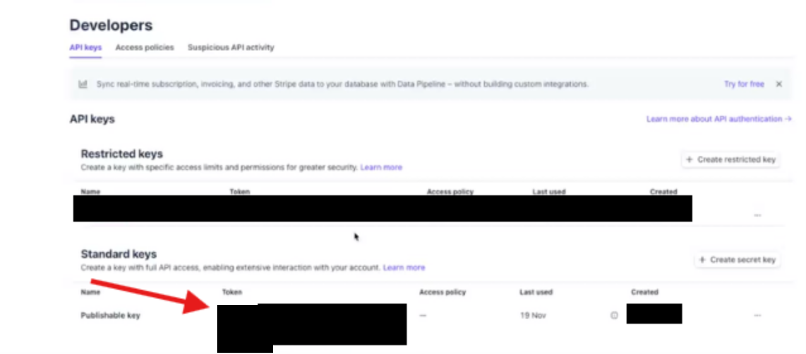
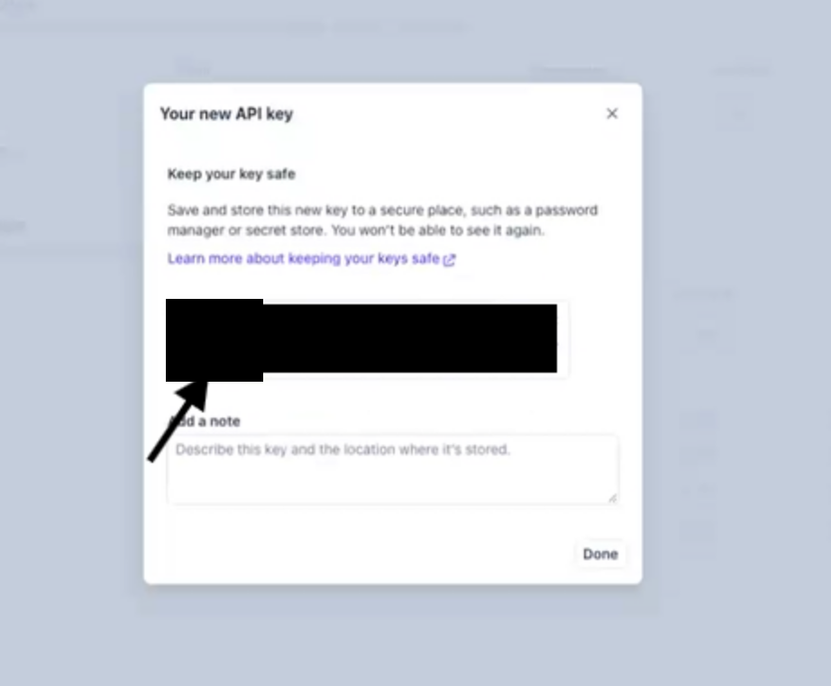

The **Trakyo** integration with Stripe tracks the payments taken through your Stripe
account and attributes each one to the content that produced it.

:::tip
Connecting Stripe gives you:

- automatic tracking of Stripe payments,
- automatic webhook setup, so events arrive in real time,
- embeddable checkout forms that carry attribution.
:::

---

## Get your Stripe API keys

**Trakyo** needs two keys: your publishable key, and a restricted key you create for it.

1. Open your **[Stripe API keys](https://dashboard.stripe.com/apikeys)**.
2. Copy your **Publishable key** — it starts with `pk_`.

3. Click **+ Create restricted key**.
4. Select **Providing this key to another website**.
5. Enter `Trakyo` as the name and `https://app.trakyo.io` as the URL.
6. Leave the permissions as they come — **all permissions**. Do not switch to custom
   permissions, or **Trakyo** cannot collect your transactions.
7. Click **Create key** and copy the restricted key.

:::warning
Stripe shows a restricted key once. Copy it before closing that window, or create another.
:::

---

## Connect it in Trakyo

Open the **[Integrations](https://app.trakyo.io/integrations)** page in **Trakyo**, find the
Stripe card, paste both keys in — publishable and restricted — and click connect.

---

## Refunds

Refunds given in Stripe are taken off your revenue, whether full or partial, and so are
chargebacks. A refund also comes off the video, post or ad that earned the sale, so those
figures — and your ROAS — change with it.

On your **[Transactions](https://app.trakyo.io/transactions)** page the refund shows with a
minus amount, dated the day it was given, not the day of the sale. The sale itself still
counts as a sale; it just no longer counts as revenue.

---

## Test the integration

1. Take a payment through Stripe, or find one you have taken recently.
2. Open **[Transactions](https://app.trakyo.io/transactions)** in **Trakyo** and check it
   is listed, with the right amount and currency.
3. Open the lead it belongs to and check the payment sits on their journey with its
   attribution.

:::warning
An empty transactions list only means something is wrong if you have actually taken
payments since connecting.
:::

---

:::info
Learn more about the **[Transactions page](/docs/help/transactions/overview)** here.
:::
