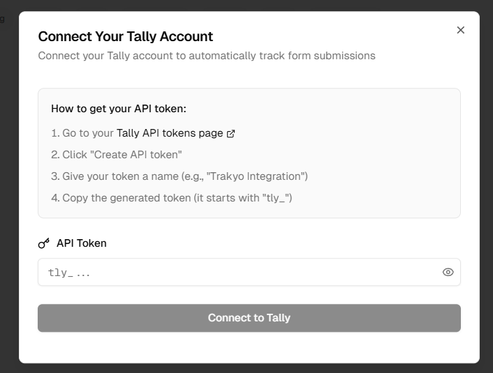
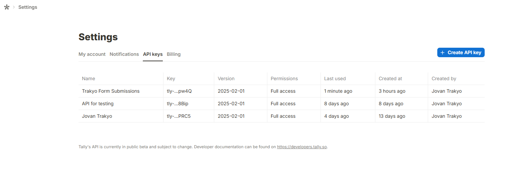
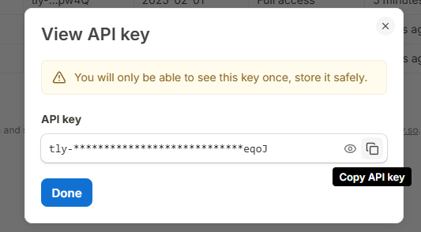
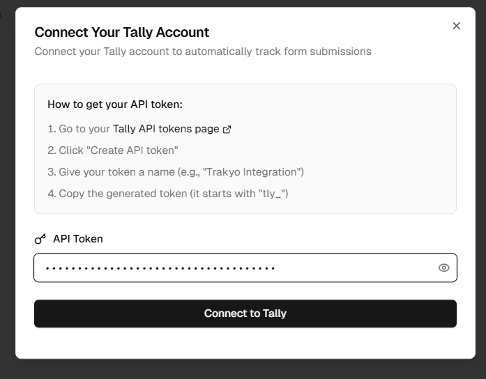
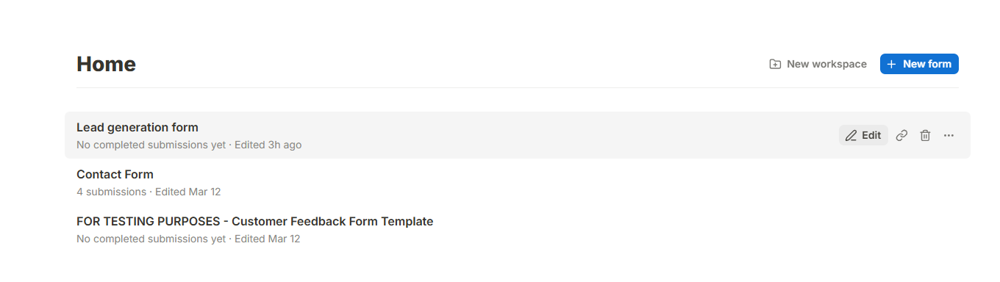
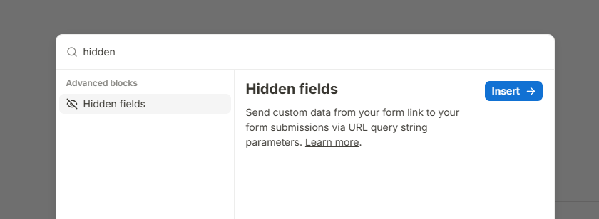
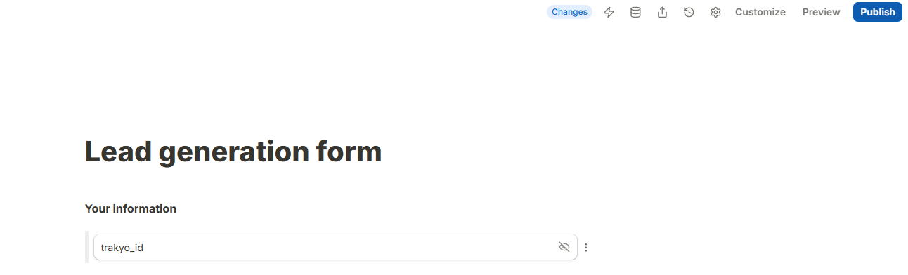
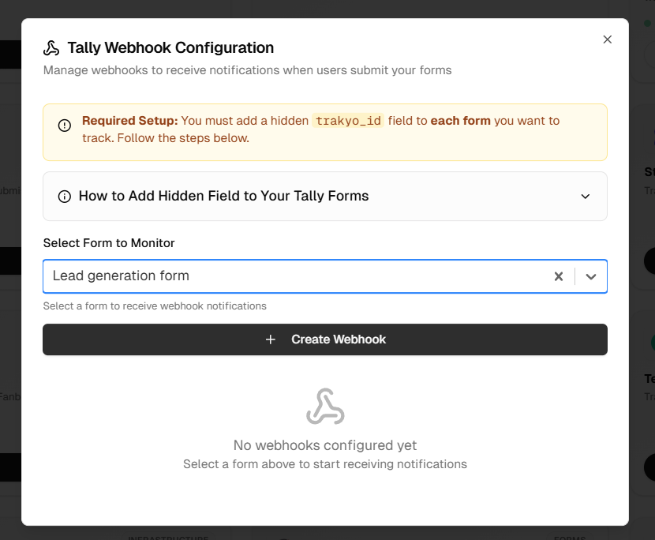

The **Trakyo** integration with Tally adds every form submission to **Trakyo** as a lead,
attributed to the content that brought that person in.

---

## Connect your Tally account

Open the **[Integrations](https://app.trakyo.io/integrations)** page in **Trakyo**, find the
Tally card and click **Connect**. The window that opens carries the same steps.

1. Open your **[Tally API tokens page](https://tally.so/settings/api-keys)**.
2. Click **Create API key** at the top right.

3. Name it, such as `Trakyo`, and click **Create**.
4. Copy the key.

:::warning
Tally shows the key once. Copy it before you close that window, or create another.
:::

5. Back in **Trakyo**, paste it into the **API Token** field and click **Connect to Tally**.

---

## Add the hidden field to each form

Every form you want tracked needs a hidden `trakyo_id` field. It carries the visitor's
fingerprint, which is what ties the submission to the visit that led to it.

1. Open your **[Tally dashboard](https://tally.so/dashboard)** and edit the first form.

2. Add a block anywhere on the form, search for `hidden`, and insert **Hidden fields**.

3. Name the field `trakyo_id`, then click **Publish** to save it.

4. Repeat for every form you want tracked.

---

## Create a webhook for each form

Back on the Tally card in **Trakyo**, click **Manage**, choose a form under **Select Form
to Monitor**, and click **Create Webhook**. Repeat for every form.

---

## Test the integration

1. Open one of your tracked forms and submit it with test details.
2. Open **[Leads](https://app.trakyo.io/leads)** in **Trakyo** and check the submission is
   listed, with the content that brought the visitor in.

:::tip
Two things worth remembering:

- Every new Tally form needs both the hidden `trakyo_id` field and its own webhook.
- Make a **[Custom Tracking](https://app.trakyo.io/custom-tracking)** link for any form you
  share with people directly, so you see in detail where each lead came from.
:::

---

:::info
Learn more about the **[Leads page](/docs/help/leads/overview)** here.
:::
