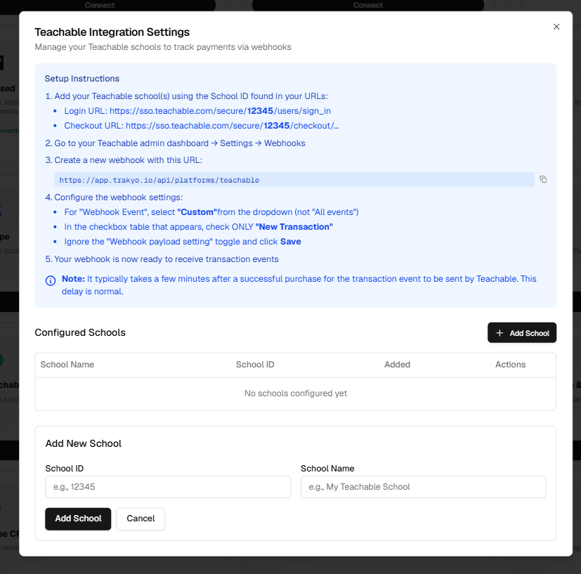

The **Trakyo** integration with Teachable tracks the transactions taken in your Teachable
school and attributes each one to the content that produced it. It takes two steps: add your
school in **Trakyo**, then create a webhook in Teachable.


---

## Add your school in Trakyo

Open the **[Integrations](https://app.trakyo.io/integrations)** page in **Trakyo**, find the
Teachable card, and click **Add School**.

You need your school's ID, which is the number in your Teachable URLs:

- Login URL: `https://sso.teachable.com/secure/12345/users/sign_in`
- Checkout URL: `https://sso.teachable.com/secure/12345/checkout/...`

In that example the School ID is `12345`. Enter it with a name you will recognise, then
click **Add School**.



:::tip
Run several schools? Add each one here, and they all report into the same **Trakyo** account.
:::

---

## Create the webhook in Teachable

1. In your Teachable admin dashboard, go to **Settings** → **Webhooks**.
2. Create a new webhook with this URL:

```text
https://app.trakyo.io/api/platforms/teachable
```

3. For **Webhook Event**, choose **Custom** from the dropdown — not **All events**.
4. In the checkbox table that appears, check **New Transaction** and nothing else.
5. Ignore the **Webhook payload setting** toggle, and click **Save**.

The webhook is now ready to receive transaction events.

---

## Test the integration

1. Make a purchase in your school, or find one made recently.
2. Open **[Transactions](https://app.trakyo.io/transactions)** in **Trakyo** and check it is
   listed, with the right amount and currency.
3. Open the lead it belongs to and check the transaction sits on their journey with its
   attribution.

:::warning
Teachable usually takes a few minutes after a purchase to send the transaction event. That
delay is normal, so give it a moment before you go looking for a problem.
:::

---

:::info
Learn more about the **[Transactions page](/docs/help/transactions/overview)** here.
:::
