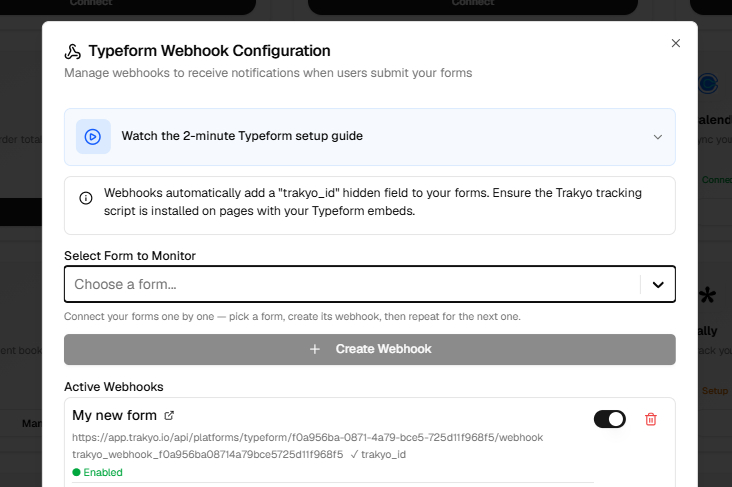
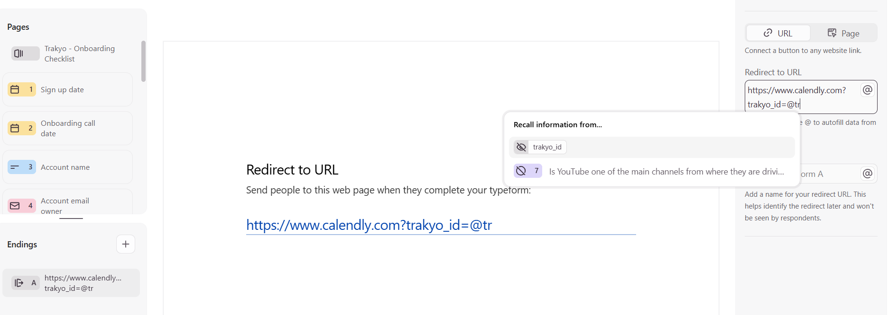
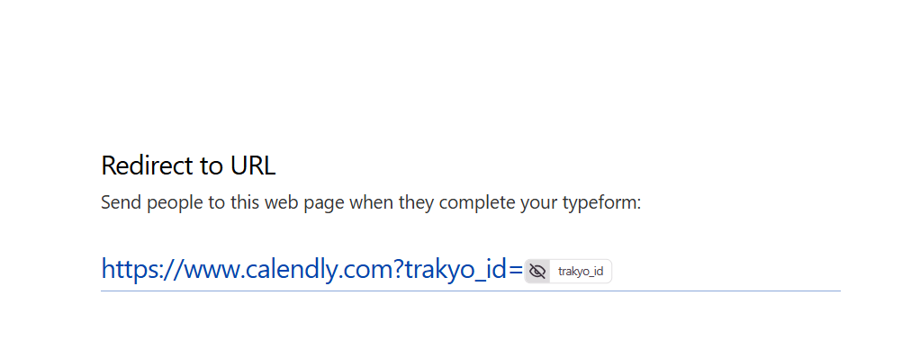

The **Trakyo** integration with Typeform adds every form submission to **Trakyo** as a lead,
attributed to the content that brought that person in.

:::warning[Tracking script required]
A submission is only tracked on a page that has the **Trakyo** tracking script in its
`<head>` tag. Install the script on every page that holds a Typeform embed.
:::

---

## Generate your personal access token

1. Open your Typeform
   **[personal tokens](https://admin.typeform.com/user/tokens)** settings.
2. Click **Generate new token**.
3. Give it a name, such as `Trakyo`.
4. Select every available scope.
5. Copy the token. It starts with `tfp_`.
6. Open the **[Integrations](https://app.trakyo.io/integrations)** page in **Trakyo**, find
   the Typeform card, paste the token into **New Personal Access Token** and save. The card
   then shows as connected.

---

## Create a webhook for each form

**Trakyo** tracks the forms you pick, one webhook per form. Choose a form under **Select
Form to Monitor** and click **Create Webhook**, then repeat for the next one. Each webhook
you make is listed under **Active Webhooks**.

:::note
Creating the webhook also adds a hidden `trakyo_id` field to that form. It carries the
visitor's fingerprint, which is what ties the submission to the visit that led to it.
:::

---

## Pass the Trakyo id to the next page

If your typeform ends by sending people somewhere else — a scheduler such as Calendly, for
instance — pass the `trakyo_id` forward, or the trail stops at the form.

1. Open the typeform and click the ending that does the redirect.
2. In the menu on the right, go to the **Redirect to URL** box and add `?trakyo_id=` to the
   end of the URL.
3. Type `@`, then `trakyo`, and pick **trakyo_id** from the list that appears.

4. The finished link carries the field at the end of it.

5. Save and publish the typeform.

---

## Test the integration

1. Open a page that holds your typeform, and check the **Trakyo** script is in its `<head>`.
2. Submit the form with test details. If the form redirects onward, follow it through to the
   end — book the call, if that is where it goes.
3. Open **[Leads](https://app.trakyo.io/leads)** in **Trakyo** and check the submission is
   listed, with the content that brought the visitor in, and with the step after the form on
   their journey.

:::tip
Even with Typeform connected, make a **[Custom Tracking](https://app.trakyo.io/custom-tracking)**
link for any form you share with people directly. You then see in detail where each lead
came from.
:::

---

## If submissions are not showing up

Work through these in order:

1. On the Typeform card in **Trakyo**, check the integration still shows as connected.
2. Check a webhook exists for the form in question. A form with no webhook is not tracked,
   and it is easy to create one against the wrong form.
3. In Typeform, open the form and look under **Connect** → **Webhooks**. The webhook
   pointing at **Trakyo** should be there and enabled.
4. Check the page holding the form has the tracking script in its `<head>`.

If all of that is in order and submissions still do not arrive, contact support through the
in-app chat and we will take a look.

---

:::info
Learn more about the **[Leads page](/docs/help/leads/overview)** here.
:::
