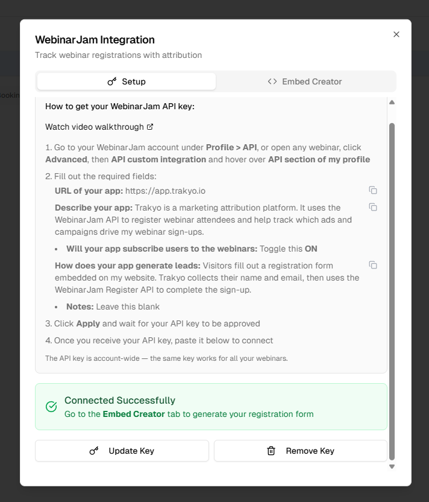
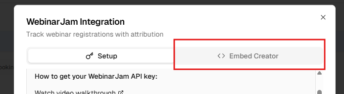
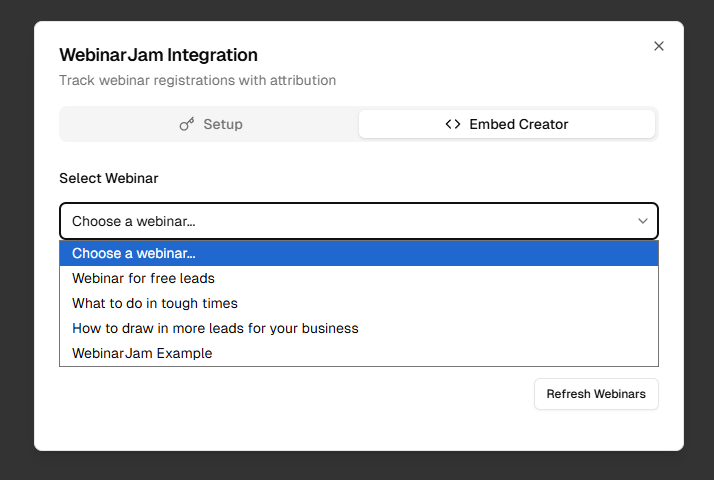
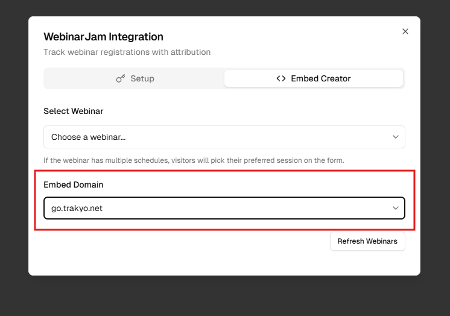
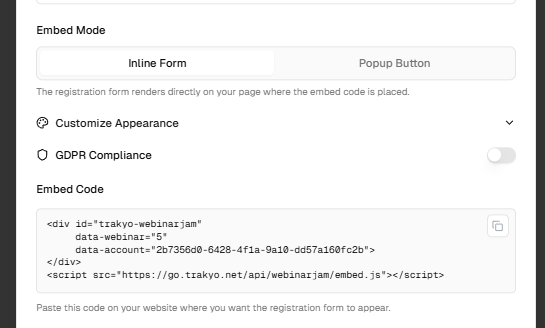
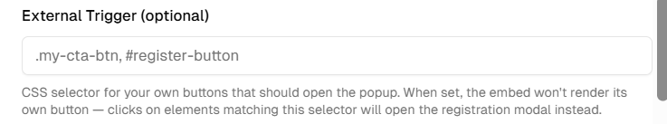
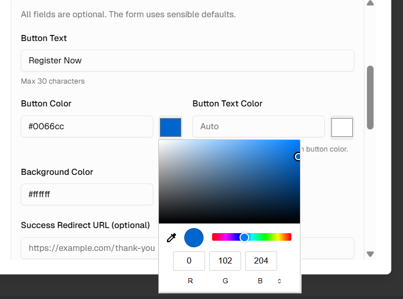
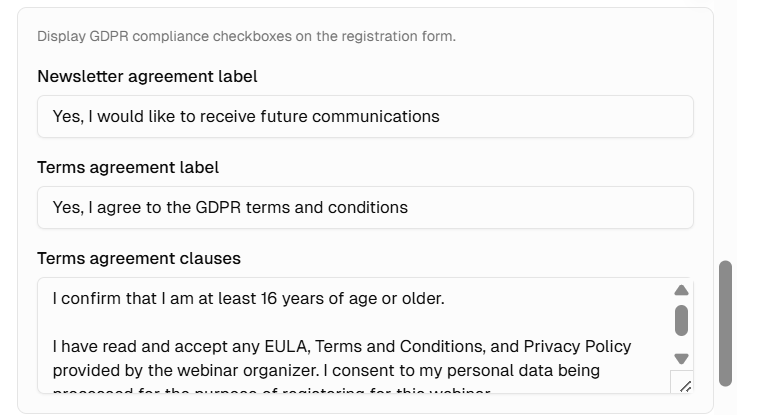
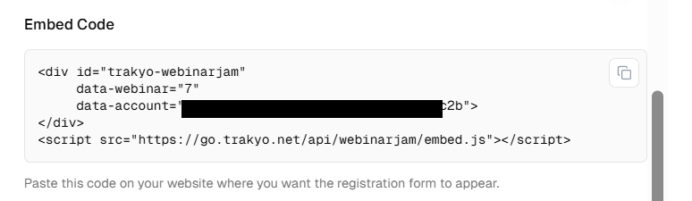

The **Trakyo** integration with WebinarJam gives you a registration form to embed on your
own site, and records every sign-up as a lead attributed to the content that brought that
person in.

:::note
It covers EverWebinar too. WebinarJam runs live webinars; EverWebinar is its sister
platform, which plays pre-recorded sessions on a repeating schedule or just-in-time, with
simulated chat, attendee counts and countdown timers. Both connect the same way — one API
key, then pick the webinar from the dropdown.
:::

---

## Get your API key

1. In WebinarJam, go to **Profile** → **API**. You can also open any webinar, click
   **Advanced** → **API custom integration**, and follow **API section of my profile**.
2. Fill in the fields:
   - **URL of your app** — `https://app.trakyo.io`
   - **Will your app subscribe users to the webinars** — toggle this **ON**
   - **Notes** — leave blank
3. Click **Apply**.

The key has to be approved by WebinarJam, which can take up to 24 hours.

:::note[If needed for the API key application, copy these two answers exactly]
**Describe your app:** Trakyo is a marketing attribution platform. It uses the WebinarJam
API to register webinar attendees and help track which ads and campaigns drive my webinar
sign-ups.

**How does your app generate leads:** Visitors fill out a registration form embedded on my
website. Trakyo collects their name and email, then uses the WebinarJam Register API to
complete the sign-up.
:::

Once you have it, open the **[Integrations](https://app.trakyo.io/integrations)** page in
**Trakyo**, find the WebinarJam card, and paste the key in to connect.

:::tip
The key is account-wide. The same one works for every webinar you run.
:::

---

## Build your registration form

Once connected, switch to the **Embed Creator** tab on the WebinarJam card.

### Pick the webinar

Choose it from **Select Webinar**.

:::note
If that webinar has several schedules, visitors pick the session they want on the form
itself.
:::

### Pick the embed domain

Choose the domain the form will live on, under **Embed Domain**.

### Choose how it appears

**Embed Mode** gives you two options. **Inline Form** renders the registration form
directly on the page, where you place the embed code. **Popup Button** puts a styled button
there instead, and the form opens in a popup when it is clicked.

A popup also offers an **External Trigger**: a CSS selector for buttons of your own. Set
one and the embed renders no button at all — clicking anything matching the selector opens
the registration form instead.

### Customise the appearance

Every field here is optional, and anything you leave blank falls back to a sensible
default.

- **Button Text** — up to 30 characters, such as `Register Now`.
- **Button Color**, **Button Text Color** and **Background Color** — as HEX, RGB or HSL.
- **Success Redirect URL** — where people go after registering. Leave it empty to show a
  success message instead.

### Add the GDPR checkboxes

Turn on **GDPR Compliance** to show consent checkboxes on the form, and write your own
newsletter label, terms label and terms clauses.

### Copy the embed code

Copy the code and paste it into the body of your page, where you want the form to appear.

:::tip
Click **Show Preview** to see the form exactly as your visitors will.
:::

---

## Test the integration

1. Open the page holding your embed and register with test details.
2. Open **[Leads](https://app.trakyo.io/leads)** in **Trakyo** and check the registration is
   listed, with the content that brought the visitor in.

:::note
Made a new webinar? Go back to the Embed Creator, click **Refresh Webinars**, pick it from
the dropdown, and copy the new embed code.
:::

---

:::info
Learn more about the **[Leads page](/docs/help/leads/overview)** here.
:::
