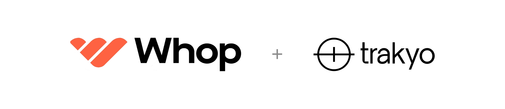
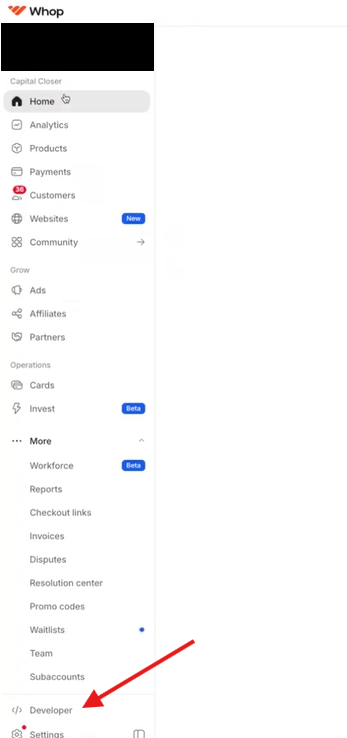
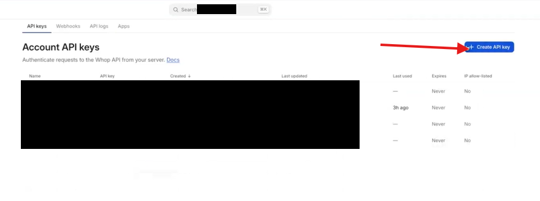
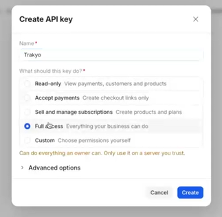
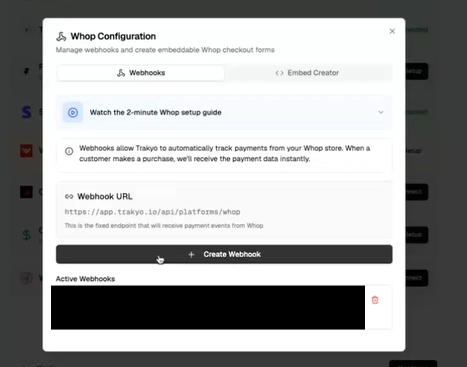

The **Trakyo** integration with Whop tracks the payments taken through your Whop account and
attributes each one to the content that produced it.

:::tip
Connecting Whop gives you:

- automatic tracking of Whop payments,
- your business id and company information,
- member data on each purchase, so sales join the right lead's journey,
- webhook events, so payments arrive as they happen,
- refunds taken off your revenue.
:::

---

## Get your Whop API key

1. Open your **[Whop dashboard](https://dash.whop.com/)** and select your Whop account.
2. Click **Developer** at the bottom left of the sidebar.

3. Click **Create API key**.

4. Enter `Trakyo` as the name and choose **Full access**.

5. Click **Create**, then copy the key.

:::warning
Choose **Full access**. On any narrower permission **Trakyo** cannot collect your
transactions.
:::

---

## Connect it in Trakyo

Open the **[Integrations](https://app.trakyo.io/integrations)** page in **Trakyo**, find the
Whop card, paste the key in and click connect.

---

## Create the webhook

The integration is finished only once the webhook exists. On the Whop card, click **Create
Webhook**. The webhook URL is fixed, so there is nothing to copy or paste.

:::note
Until the webhook is created, payments taken on Whop do not reach **Trakyo**.
:::

---

## Refunds

A refund given on Whop is taken off your revenue. It also comes off the video, post or ad
that earned the sale, so those figures — and your ROAS — change with it.

On your **[Transactions](https://app.trakyo.io/transactions)** page the refund shows as a
refund with a minus amount, dated the day it was given, not the day of the sale. The sale
itself still counts as a sale; it just no longer counts as revenue.

:::warning
Disputes and chargebacks are not deducted. Only refunds given on Whop are.
:::

---

## Test the integration

1. Take a payment through Whop, or find one you have taken recently.
2. Open **[Transactions](https://app.trakyo.io/transactions)** in **Trakyo** and check it is
   listed, with the right amount and currency.
3. Open the lead it belongs to and check the payment sits on their journey with its
   attribution.

---

:::info
Learn more about the **[Transactions page](/docs/help/transactions/overview)** here.
:::
