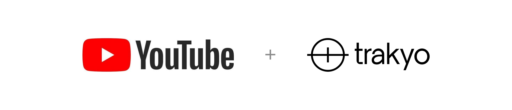
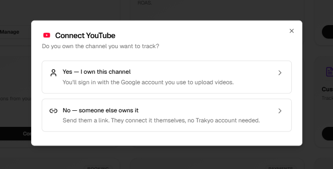
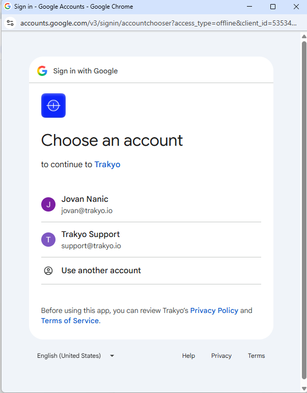
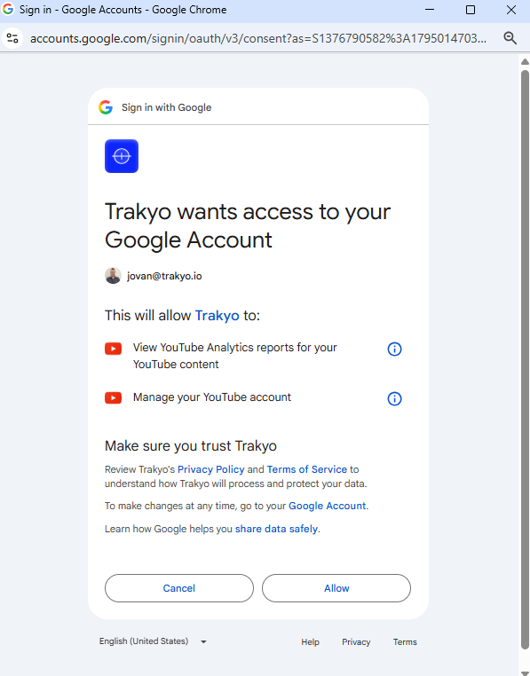

The **Trakyo** integration with YouTube lets you connect one or more of your channels, loads
every video from them, and manages your video descriptions directly from **Trakyo**.

:::tip
The best way to connect a YouTube channel is from the channel owner's Gmail account.
Accepting all permissions is mandatory — **Trakyo** needs that access to update your video
descriptions.
:::

---

## Connect your YouTube channel

:::warning
Manager access is no longer enough. **Owner access is what works.** The only alternative is
a user with brand account access, and YouTube is unreliable even then — so for a connection
that holds, use the channel owner's account.
:::

There are two ways to connect:

- **The owner connects it in Trakyo.** They log in and connect the channel from the
  Integrations page.
- **The owner connects it remotely.** You generate a connection link and send it to them.
  They connect the channel themselves, from any device, without a Trakyo account and
  without sharing credentials with you.

### Before you start

- **Your channels use brand account permissions.** The YouTube API only works with brand
  accounts. If yours are not set up that way yet, see
  [Add brand account permissions](#add-brand-account-permissions) below.
- **The Google account you connect is a Manager or Owner of the channel**, granted through
  brand account permissions — not through YouTube Studio's regular access settings.
- **Pick the correct brand account during login.** A brand account and its YouTube channel
  are the same thing. If your Google account manages several, choose the right one.
- **Grant every permission** on Google's screen: View account, Manage videos, View
  analytics.

### Step-by-step guide

Open the **[Integrations](https://app.trakyo.io/integrations)** page in **Trakyo** and find
the YouTube card to start.

1. **If you own the channel:** choose **Yes — I own this channel**, then click **Connect
   YouTube**.
2. **If someone else owns it:** choose **No — someone else owns it**, send them the link
   Trakyo generates, and they open it. The rest of the steps are the same for them.
3. Select the Gmail account that owns the channel.

4. Allow every permission Trakyo asks for, then click **Allow**.

The channel now shows as connected on the YouTube card. To add another, click the button to
connect another channel and run through the same steps with that channel's owner account —
there is no limit, and several channels can sit on one Trakyo account.

:::note
The remote connection link needs the **Gmail address tied to the channel**, not Trakyo login
details. This catches people out.
:::

---

## After you connect

**Trakyo** imports your videos automatically. Open
**[YouTube Tracking](https://app.trakyo.io/youtube-tracking)** to check. If they do not
appear straight away, click **Refresh Videos** at the top right of the screen.

How long the sync takes depends on how many videos the channel holds — the more videos, the
longer it takes, up to a few minutes at most.

Unlisted and private videos are loaded alongside your public ones.

If no videos show up at all, you have selected the wrong Gmail account, or the right Gmail
account but the wrong YouTube channel attached to it.

:::warning
Connections can expire silently. If a channel stops showing its videos, the owner has
probably changed the channel's email address, or the brand account permissions have
changed. The fix is easy: have the owner reconnect the channel from **Integrations** → the
YouTube card.
:::

---

## Add brand account permissions

YouTube changed how channel permissions work, so a team member who connects a channel on
your behalf has to be added through brand account permissions first. This is also what
allows **Trakyo** to update your video descriptions with tracking links.

1. Log in to your channel in YouTube Studio.
2. Go to **Settings** at the bottom left, then **Permissions**.
3. Opt out of managing permissions in YouTube Studio, using the link on that screen: tick
   every box, then confirm.
4. Confirm this is the channel whose permissions you want to change.
5. Click **Manage permissions** and verify it is you.
6. Invite your team member and give them the **Manager** role. Either role works, but
   Manager is the usual choice for someone who only needs to connect the channel.
7. Click **Done**. The invitation is sent.

Your team member then opens the **[Integrations](https://app.trakyo.io/integrations)** page
in **Trakyo** and reconnects the YouTube channel using the email address tied to that brand
account.

_[Video: setting up brand account permissions]_

:::info
Learn more about [YouTube Tracking](/docs/help/youtube-tracking/overview) here.
:::
