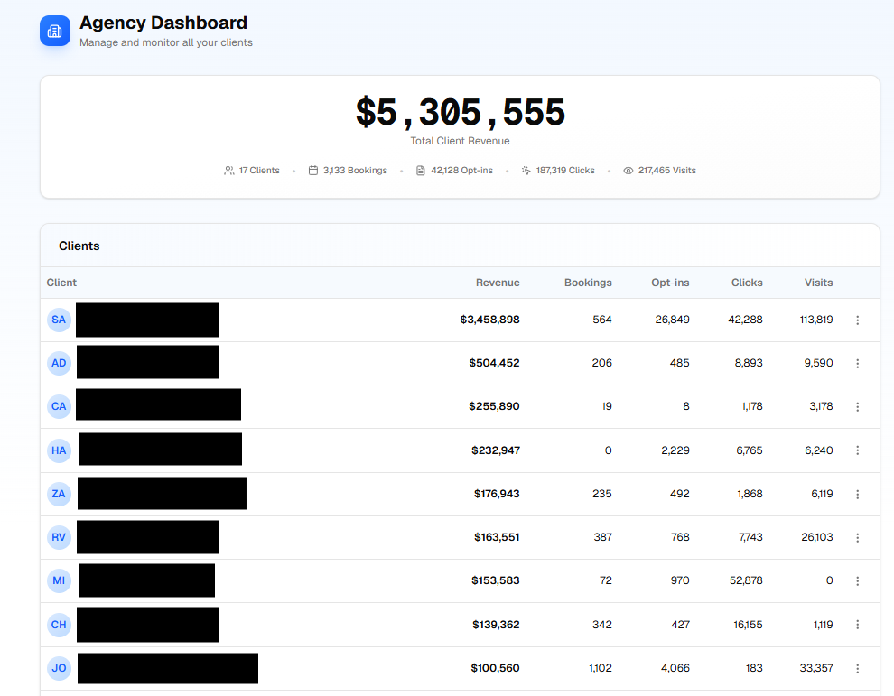
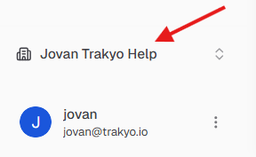
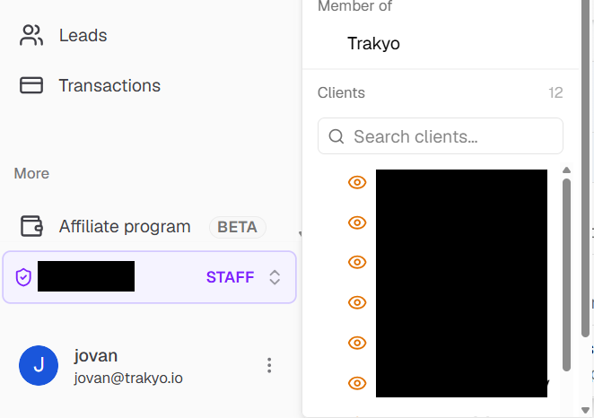

If you run **Trakyo** for other people, the agency view puts every client account in one
dashboard, and lets you move between them without signing out.

---

## The agency dashboard

**Total Client Revenue** sits at the top, with the totals behind it: how many clients you
manage, and their bookings, opt-ins, clicks and visits added together.

Below that, **Clients** lists one row per account — revenue, bookings, opt-ins, clicks and
visits — sorted by revenue, so your biggest account is first. The menu at the end of a row
opens the actions for that client.

---

:::note
Running an agency and being a **Trakyo** affiliate are not exclusive — you can do both. See
**[Affiliate program](/docs/help/affiliate-program/overview)** for how the affiliate side
works, and get in touch to hear about the partnership.
:::

## Switch between accounts

The switcher is at the bottom left of the sidebar, under your own name.

Open it and you get your own account at the top, under **Member of**, and your **Clients**
below with a count and a search box. Click the eye beside a client to work in that account.
Everything in **Trakyo** — dashboard, leads, transactions, integrations — then shows that
client's data until you switch back.

:::tip
Searching beats scrolling once you manage more than a handful of accounts.
:::

---

## How an account becomes your client

Share your account's invite link. Anyone who signs up through it is created as a child
account under your agency, and appears in this list. You will find the link on the
**General** tab of **[Settings](/docs/help/settings/overview)**.

---

:::info
Learn more about **[Settings](/docs/help/settings/overview)** here.
:::
