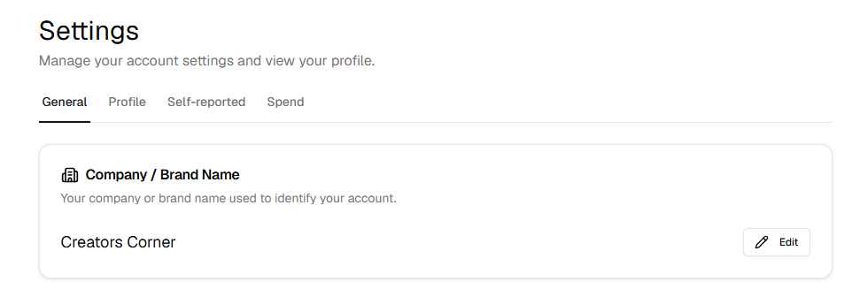
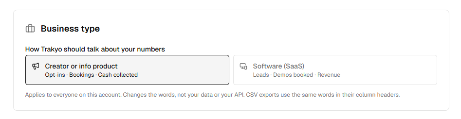

Settings is where you name your account, set your timezone and currency, invite new users,
and choose how **Trakyo** talks about your numbers. It has four tabs: **General**,
**Profile**, **Self-reported** and **Spend**.

---

## General

### Company / Brand Name

The company or brand name that identifies your account. Click **Edit** to change it.

---

### Invite link

Your account's own sign-up link. Share it and anyone who opens it can create a **Trakyo**
account.

:::warning
An account created through your link becomes a child account of yours, under your agency.
:::

---

### Regional settings

Choose your timezone, or leave **Auto-detect from browser** ticked and **Trakyo** follows
the device you are on. This is what every date and time in your account is shown in.

---

### Display currency

Choose the currency your account shows amounts in.

:::tip
A payment taken in another currency is converted for you, at the exchange rate on that
transaction's own date — not today's.
:::

---

### Business type

This sets the words **Trakyo** uses for your numbers, on your dashboard, across the other
pages, and when your AI assistant talks about your data.

- **Creator or info product** — opt-ins, bookings, cash collected.
- **Software (SaaS)** — leads, demos booked, revenue.

:::note
It applies to everyone on the account, and it changes the words rather than your data or
your API. CSV exports use the same words in their column headers.
:::

---

### Appearance

Choose a **Light** or **Dark** theme, or **System** to follow whatever your computer is
set to.

---

:::info
Learn more about your **[Team](/docs/help/settings/team)** here.
:::
