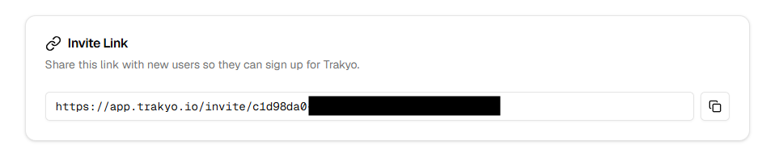
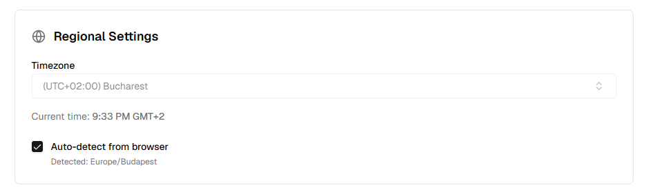
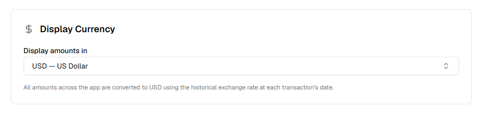
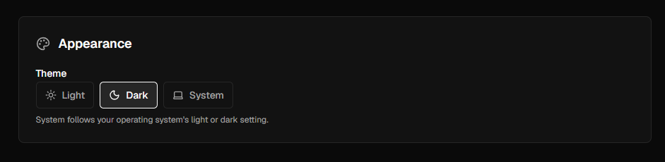
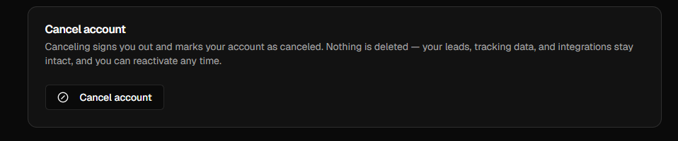
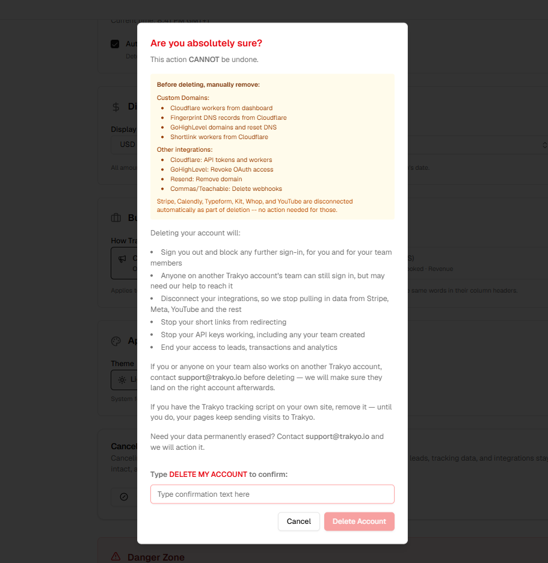
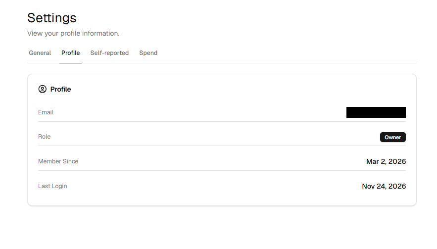
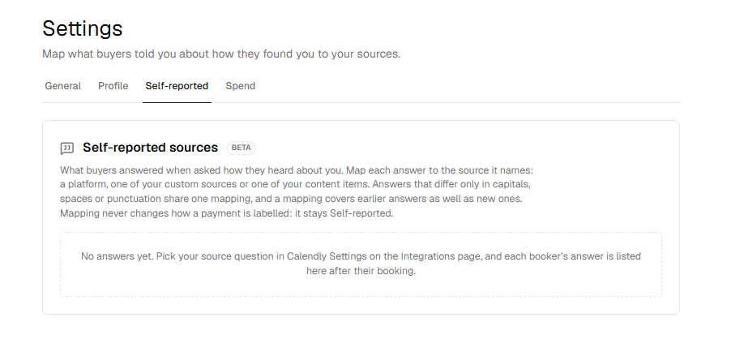

Settings is where you name your account, set your timezone and currency, invite new users,
and choose how **Trakyo** talks about your numbers. It has four tabs: **General**,
**Profile**, **Self-reported** and **Spend**.

---

## General

### Company / Brand Name

The company or brand name that identifies your account. Click **Edit** to change it.

---

### Invite link

Your account's own sign-up link. Share it and anyone who opens it can create a **Trakyo**
account.

:::warning
An account created through your link becomes a child account of yours, under your agency.
:::

---

### Regional settings

Choose your timezone, or leave **Auto-detect from browser** ticked and **Trakyo** follows
the device you are on. This is what every date and time in your account is shown in.

---

### Display currency

Choose the currency your account shows amounts in.

:::tip
A payment taken in another currency is converted for you, at the exchange rate on that
transaction's own date — not today's.
:::

---

### Business type

This sets the words **Trakyo** uses for your numbers, on your dashboard, across the other
pages, and when your AI assistant talks about your data.

- **Creator or info product** — opt-ins, bookings, cash collected.
- **Software (SaaS)** — leads, demos booked, revenue.

:::note
It applies to everyone on the account, and it changes the words rather than your data or
your API. CSV exports use the same words in their column headers.
:::

---

### Appearance

Choose a **Light** or **Dark** theme, or **System** to follow whatever your computer is
set to.

---

### Cancel your account

Cancelling signs you out and marks the account as cancelled. Nothing is deleted — your
leads, tracking data and integrations all stay as they are, and you can reactivate at any
time.

---

### Delete your account

Deleting is the other option, and it is permanent.

:::danger
Deleting an account cannot be undone. **Trakyo** asks you to type `DELETE MY ACCOUNT` to
confirm.
:::

Deleting will:

- sign you out and block any further sign-in, for you and for your team,
- disconnect your integrations, so **Trakyo** stops pulling in data from Stripe, Meta,
  YouTube and the rest,
- stop your short links redirecting,
- stop your API keys working, including any your team created,
- end your access to leads, transactions and analytics.

Anyone on your team who also belongs to another **Trakyo** account can still sign in,
though they may need our help to reach it.

**Before you delete, remove these by hand.** If you use custom domains: your Cloudflare
workers, the fingerprint DNS records in Cloudflare, your GoHighLevel domains and DNS, and
the shortlink workers in Cloudflare. For other integrations: Cloudflare API tokens and
workers, GoHighLevel OAuth access, your Resend domain, and the Commas and Teachable
webhooks.

:::note
Stripe, Calendly, Typeform, Kit, Whop and YouTube disconnect themselves as part of the
deletion. There is nothing to do for those.
:::

Two more things:

- If you or anyone on your team also works on another **Trakyo** account, email
  **[support@trakyo.io](mailto:support@trakyo.io)** before deleting, so we can make sure
  they land on the right account afterwards.
- If the **Trakyo** tracking script is on your site, take it out. Until you do, your pages
  keep sending visits to **Trakyo**.

To have your data erased permanently, email
**[support@trakyo.io](mailto:support@trakyo.io)** and we will action it.

---

## Profile

What **Trakyo** holds about you: your email address, your role on this account, the date
you joined and when you last signed in. It is there to read, not to edit.

:::note
To change an email address, see **[Team](/docs/help/settings/team)**.
:::

---

## Self-reported

Some buyers never click a tracked link — they heard you on a podcast, or a friend sent
them. This tab is where you turn what they tell you into a source.

### Where the answers come from

An answer reaches **Trakyo** from any of these, once you pick the question or field:

- **Bookings** — Calendly, HubSpot Meetings, GoHighLevel calendars and iClosed. You choose
  your existing "How did you hear about us?" question on that integration's card.
- **Forms** — Typeform and Tally. You choose the form's source field.
- **Custom webhooks** — the form, booking and transaction webhooks take an optional
  `self_reported_source` field.
- **Trakyo checkout pages** — an optional question on the first step of Stripe and Whop
  checkouts. Switch it to Required or Off here.

### Map the answers to a source

Every answer people gave is listed on this tab. Map each one to the source it names: a
platform, one of your custom sources, or a single piece of content. So "YT", "youtube" and
"saw your video" can all point at YouTube.

Answers that differ only in capitals, spaces or punctuation share one mapping, and a
mapping covers the answers already collected as well as new ones.

:::warning
Mapping never relabels a payment. It stays **Self-reported**, kept apart from the revenue
**Trakyo** tracked itself.
:::

### What it does not do

- **A tracked source always wins.** An answer only fills a gap, and it never changes a sale
  **Trakyo** already tracked. Your totals do not move — revenue shifts out of **Other**
  into **Self-reported**.
- **Nothing is backfilled.** Answers count from the moment you pick the question. A new
  answer can still credit that person's own earlier untracked payments.
- **A buyer who skips the question stays unattributed.**
- **The dashboard shows one Self-reported row**, not a split by mapped source. The mapping
  shows here and on each lead.
- **The checkout question's wording is fixed**, and renewals are not asked again. Setting
  it to Required adds a step to your checkout, so Optional is the safer choice.

---

:::info
Learn more about your **[Team](/docs/help/settings/team)** here.
:::
