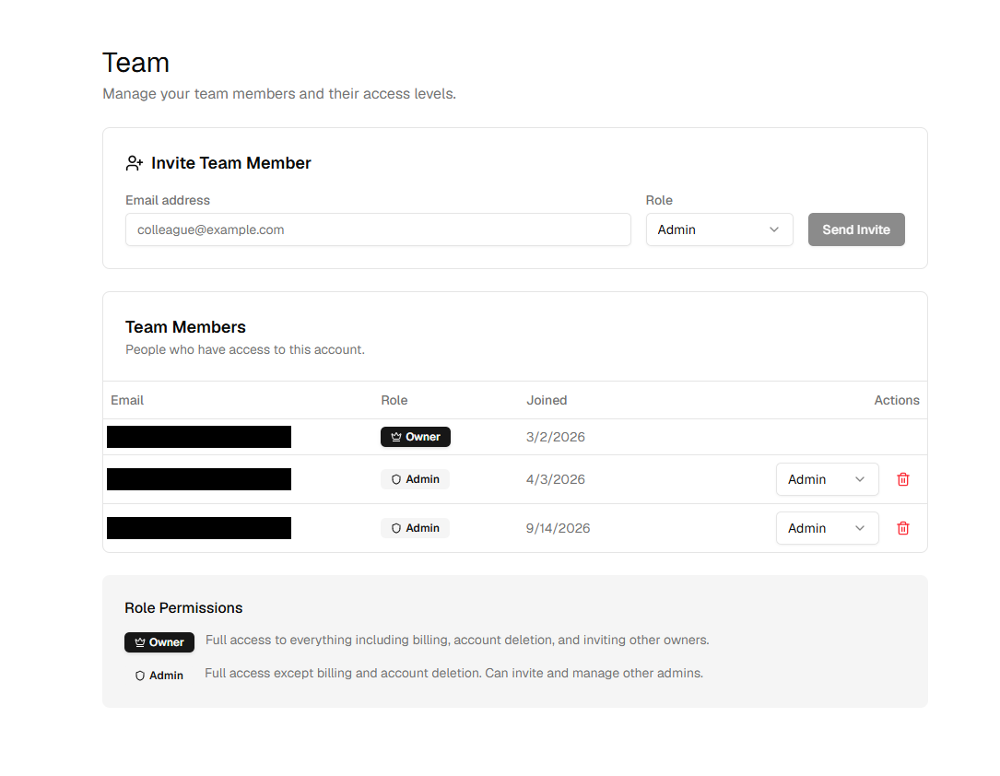

The Team page is where you invite people to your **Trakyo** account, see who already has
access, and set what each of them can do.

---

## Invite someone

1. Open the Team page in **Trakyo**.
2. Enter their email address under **Invite Team Member**.
3. Choose their **Role**.
4. Click **Send Invite**.

They appear under **Team Members** with the date they joined.

---

## What each role can do

- **Owner** — full access to everything, including billing, deleting the account, and
  inviting other owners.
- **Admin** — full access apart from billing and deleting the account. An admin can invite
  and manage other admins.

---

## Change someone's role

In the **Team Members** list, open the dropdown in their row and pick the new role.

:::note
The owner's role cannot be changed from this list.
:::

---

## Remove someone

Click the bin icon in the **Actions** column of their row. They lose access to the account.

---

:::info
Learn more about **[Settings](/docs/help/settings/overview)** here.
:::
